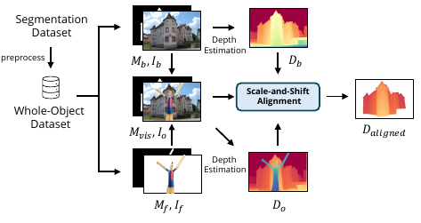
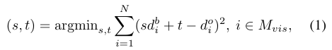
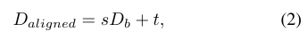
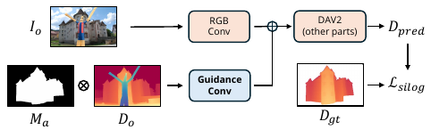
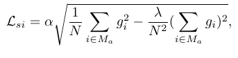
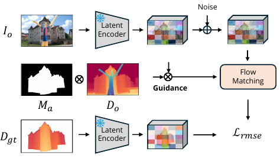
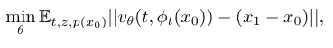
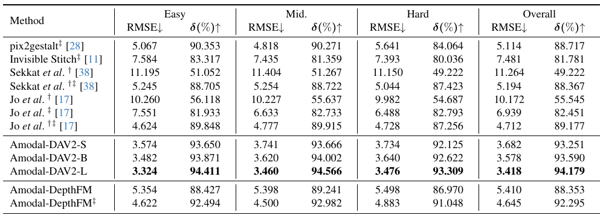
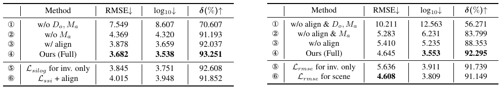

# Amodal Depth Anything｜Nature Reader 源文定位精读

**范围声明：**这是按本任务要求生成的结构化、源文对照式精读附加结果，**不是全文翻译**。保留少量英文短选段及中文对照，其余是标有来源的中文释读；不把释读冒充原文翻译。完整机制批判、PaperForge 十二段和三个 ARIS idea 见[精读长文](../amodal-depth-anything.md)。

**源文：**ICCV 2025 正式版，PDF 10 页，对应论文集 pp.9673–9682。[正式页面](https://openaccess.thecvf.com/content/ICCV2025/html/Li_Amodal_Depth_Anything_Amodal_Depth_Estimation_in_the_Wild_ICCV_2025_paper.html)；[PDF](https://openaccess.thecvf.com/content/ICCV2025/papers/Li_Amodal_Depth_Anything_Amodal_Depth_Estimation_in_the_Wild_ICCV_2025_paper.pdf)。本地 Zotero：`每日精读论文/2026/10`，条目 `TD5LA8C6`、附件 `UM6KKHEX`。阅读月份为 2026-10，不等于发表月份 2025-10。

**证据标签：**【原文事实】可从指定页核查；【证据解释】是我们的机制分析；【研究假设】是未运行、未完成新颖性检验的提议。

## 导航

- [S001 摘要与问题](#S001) · PDF p.1
- [S002 引言与相关工作](#S002) · p.1–3
- [S003 输入与输出](#S003) · p.2–4
- [S004 数据构造](#S004) · p.4
- [S005 两种模型](#S005) · p.4–5
- [S006 训练与推理](#S006) · p.5、7
- [S007 实验与基线](#S007) · p.6–7
- [S008 讨论与结论](#S008) · p.7–8
- [S009 证据边界](#S009)
- [术语表](#glossary) · [提取和未核验说明](translation_notes.md) · [源地图](source_map.json)

## 公式索引

- [E001 · 原式(1)](#E001)：p.4，可见区尺度与平移拟合。
- [E002 · 原式(2)](#E002)：p.4，把换算应用于整张遮挡前深度。
- [E003 · 无原编号](#E003)：p.5，完整对象上的对数深度损失。
- [E004 · 无原编号](#E004)：p.5，条件流匹配与插值路径。

## 摘要：先确认研究对象

**Source:** p.1 S001 · Abstract

**Original:** “Amodal depth estimation”

**中文:** “包含被遮挡部分的深度估计”。这里的 amodal 不是另一种传感器，而是指输出覆盖当前看不到、却属于目标对象的部分。

【原文事实】作者把任务设为自然图像中的相对深度，提出 ADIW 数据构造，以及 Amodal-DAV2 和 Amodal-DepthFM 两个分支。正式摘要报告相对先前方法 50.7% 的 RMSE 改善。这个百分比必须带比较对象；[T001](#T001)解释为什么不能直接将它与正文 27.4% 混用。

【证据解释】物体被桌面遮住时，普通深度会报告桌面的深度，本文要预测桌面后那个目标的表面深度。它不是完整实体建模：同一条射线更后面的背面、内部和厚度并没有由一个相对深度值确定。

## 引言与相关工作：标签缺少，还是信息本来就不存在？

**Source:** p.1–3 S002 · §1–2

【原文事实】以往工作依赖合成数据和度量深度，作者认为这限制自然场景泛化。本文借助普通分割数据和预训练深度模型扩展监督。对照涉及直接 amodal depth、先补 RGB 的 pix2gestalt、Invisible Stitch，以及 DAV2、DepthFM 两类深度基础模型。

【证据解释】这里有两个不同困难。第一是训练缺少“遮挡前真实样子”的标签，合成遮挡能补上部分监督；第二是测试时的隐藏几何并不唯一，增加训练样本也不能把这一单图问题变成完全可观测。论文主要改善第一点，并借先验应对第二点，不能说解决了第二点的唯一真值恢复。

## 任务定义：给了什么条件，没给什么条件？

**Source:** p.2 Fig.2、p.3–4 §3.1

【原文事实】输入包括 RGB、观察深度和目标 amodal mask。完整 mask 可以经上游方法或人交互得到，本文不能同时被描述成“无需条件自动找到所有物体的完整形状”。输出是当前相机下目标的相对深度。

【证据解释】mask 解决“这一像素应该解释成谁”，观察深度提供前景和可见目标的几何上下文，预训练先验补足隐藏部分。条件错误不会被大模型自动变成正确测量；特别是 mask 把遮挡物划给目标时，归属错误会进入后续所有估计。

## 数据方法：为什么要先对齐？

**Source:** p.4 S004 · §3.2

**Original:** “Constructing Training Data.”

**中文:** “构造训练数据。”这里的构造不只是把两张图片粘在一起，还要处理粘贴前后深度模型输出的数值规约变化。

### Fig.3｜从完整对象到遮挡监督

**Source:** p.4 F001 · 原图3，裁剪仅保留图形；图注要点为中文释读，不是逐字译文。

【原文事实】先筛选较完整对象，再叠加遮挡物。遮挡前后分别估深度，在共同可见区拟合尺度和平移，构成约 564K 样本的 ADIW。

【证据解释】同一物体的真实结构没有变化，但相对深度网络会受整张图的上下文影响；遮挡前后两次输出可能不能直接按数值拼接。拟合试图修复这个问题。它要求误差近似能由两个参数解释，而不是任意局部变形。

**Source:** p.4 E001 · Eq. (1) · medium confidence，按页面核对转写

$$
(s,t)=\operatorname*{argmin}_{s,t}\sum_{i=1}^{N}(s d_i^b+t-d_i^o)^2,\quad i\in M_{\mathrm{vis}}.
$$

【原文事实】$d_i^b$、$d_i^o$ 为遮挡前后深度，$N$ 是共同可见区域的有效像素数。不是拿隐藏答案求解。图中原下标排版略紧，原图与本式共同保留。

**Source:** p.4 E002 · Eq. (2) · medium confidence

$$
D_{\mathrm{aligned}}=sD_b+t.
$$

【证据解释】这一步把可见区学到的换算用于隐藏区，属于外推。若可见部分近似等深，尺度和平移难分；若教师局部扭曲，仿射换算不够。论文未做该条件数压力测试。

## 模型方法：直接回归与生成式路径不能混为一谈

**Source:** p.4–5 S005 · §3.3

**Original:** “Amodal Depth Estimator”

**中文:** “包含遮挡部分的深度估计器。”本文分别适配确定式 DAV2 和生成式 DepthFM，不是把两个网络串成必须依次运行的流水线。

### Fig.4｜DAV2 条件支路

**Source:** p.5 F002 · 原图4

【原文事实】新增 Guidance Conv 接收深度和 mask，零初始化使训练开始时不扰乱预训练 RGB 路径；在 DPT head 输入加入 layer norm，整体微调。损失在完整目标上计算，不仅在洞内计算。

**Source:** p.5 E003 · 原文无编号 · medium confidence

$$
\mathcal L_{si}=\alpha\sqrt{\frac{1}{N}\sum_{i\in M_a}g_i^2-\frac{\lambda}{N^2}\left(\sum_{i\in M_a}g_i\right)^2},\qquad
g_i=\log\tilde d_i-\log d_i.
$$

【原文事实】$M_a$ 是完整对象 mask，$\lambda=0.85$ 见 p.7。可见部分也参与监督，作者解释为促进整体结构学习。【证据解释】减去均值项削弱全局比例误差，但 $\lambda$ 不等于 1，因此不是对尺度严格完全不敏感；更不是对加性平移也不变。全对象监督可能改善接缝，也应防止大块可见部分掩盖小而重要的隐藏细节。

### Fig.5｜DepthFM 的 latent 条件流

**Source:** p.5 F003 · 原图5

**Source:** p.5 E004 · 原文无编号 · medium confidence，保留原文范数未平方的写法

$$
\min_\theta\mathbb E_{t,z,p(x_0)}
\left\|v_\theta(t,\phi_t(x_0))-(x_1-x_0)\right\|,\qquad
\phi_t(x\mid z)=tx_1+(1-t)x_0.
$$

【原文事实】$x_0$ 是输入图像的 latent，$x_1$ 是深度 latent；$z$ 包括图像、观察深度与 mask。训练另加 Gaussian noise。第一卷积保留原 8 通道预训练权重，额外两个条件通道零初始化。不是强化学习，没有奖励函数。

【证据解释】拟合的是从图像编码向深度编码移动的速度，而不是机械套用所有“纯噪声到图像”版本。原式省略部分条件记号，附近文字存在 $M_o/M_a$ 记号不一致；本读本不替作者猜测隐藏定义。生成式参数化可以表达随机输出，但论文没有充分证实固定条件多采样的真实分布覆盖。

## 训练与推理：谁需要后处理对齐？

**Source:** p.5、7 S006 · §3.3.2、§4.2

**Original:** “Scale-and-Shift Alignment Inference.”

**中文:** “推理时的尺度—平移对齐。”这是生成分支修正解码深度规约的方法，不是默认 DAV2 的必经步骤。

【原文事实】DAV2 直接回归；DepthFM 解码后在共享可见区对齐并混合观察深度。训练使用深度预训练参数和 4 张 A100。公开仓库给出推理入口与权重链接，但训练/数据文档还有 TBD；本机未运行模型。

【证据解释】在错误很小的回归结果上再拟合两个参数，会把可见区噪声外推到隐藏区；在生成分支的整体漂移较大时，它又可能有益。不能把“后处理越多越好”当结论。

## 结果：每个数字到底回答哪个问题？

**Source:** p.6–7 S007 · Table 1–3

### Table 1｜不可见区域比较

**Source:** p.6 T001。RMSE 表内乘 100；不是米制误差。下表仅转录讨论所需行，图中保留完整比较及符号。

| 方法 | Overall RMSE | 对照应如何理解 |
|---|---:|---|
| Jo 原模型＋对齐 | 6.939 | 没有同数据重训 |
| Jo 重训＋对齐 | 4.712 | 数据适配后更严格的比较 |
| DAV2-S / B / L | 3.682 / 3.578 / 3.418 | 本验证协议上 L 最优 |
| DepthFM / 加对齐 | 5.410 / 4.645 | 对齐有益，但非最佳结果 |
| pix2gestalt＋对齐 | 5.114 | RGB 中介可能形成误差传递 |

【证据解释】50.7% 和 27.4% 可分别由两个 Jo 基线反算得到：前者相对 6.939，后者相对 4.712。这是我们的算术核对，不是作者的明确澄清。预印本摘要的 69.5% 不沿用到正式版。

### Table 2–3｜条件、监督区域、对齐的作用

**Source:** p.7 T002。两个表并置，保留列标题；不混用两种主干的绝对数值。

【原文事实】DAV2-S 去深度和 mask 后 RMSE 7.549，只去 mask 为 4.369，完整为 3.682；只监督隐藏区为 3.845。加推理对齐反而变成 3.878。DepthFM 对齐则从 5.410 改善至 4.645。

【证据解释】这些消融支持条件和整体监督在该配置中的价值，也支持“对齐收益依误差结构而变”。它们不证明所有条件变化都安全，也不等于等参数、等计算的因果排除。

## 讨论与真正留下的结论

**Source:** p.7–8 S008 · §4.3–5

【原文事实】作者讨论 RGB 修复造成深度级联误差，并给出边缘分析：DAV2-S 总体 3.682、边缘 7.378、非边缘 3.515。Fig.8 是改变 mask 条件的结果，不是同一输入多次采样统计。

【证据解释】边缘为何更难？第一层是深度不连续，几个像素的错位就能把前景深度赋给后景；更深层是教师伪标签、下采样表示和平均误差目标都不天然保护薄结构/拓扑。论文没有隔离这些来源，因此不能断言其中某一个已经被实验证明是根因。

真正可靠的收获是“目标条件＋监督构造可以让深度基础模型补出有用的隐藏表面先验”。不是“单张图已经测量到完整三维真值”。

## 术语表：作用、删除后行为与失效场景

| 英文 | 中文与直觉 | 在系统中作用 | 删除或误用后的行为 |
|---|---|---|---|
| amodal mask | 包含被遮住部分的目标轮廓 | 定义目标归属与支持域 | 缺失会混淆目标；扩张错误会逼模型补不存在区域 |
| relative depth | 相对深度，刻度未必为米 | 用自然图像教师获得规模化几何监督 | 当成米制会错误融合多视角 |
| scale-and-shift alignment | 换刻度和零点 | 匹配可见区的规约，再外推 | 近等深样本无法稳定分离两参数 |
| guidance convolution | 条件卷积支路 | 把深度和轮廓接入已有表示 | 没有条件会弱化目标选择；错误条件也会误导 |
| Silog | 对数深度误差的尺度抑制项 | 降低整体比例对优化的影响 | 不代表平移也无所谓；可见面积会影响梯度占比 |
| conditional flow matching | 学条件速度场 | 在 latent 中学习图像到深度的路径 | 没有新增测量，先验错误不会因“生成式”自动消失 |
| pseudo ground truth | 伪真值，教师产物 | 替代难取得的完整深度监督 | 教师偏差可被学生继承，必须用独立真值审计 |

## 证据边界、未解决问题与三维连接

【原文事实】已核对正式版 p.4–7 的结构、公式和表格画面；其他页的图像本次没有逐图视觉验真。正文可提取，非扫描 PDF。没有将预印本与正式版混成单一实验。

【证据解释】任务无法区分相同可见投影却不同背面的对象，这是可观测性限制。标签与初始化共享教师可能放大共同偏差，这是替代解释而非数据泄漏指控。公开代码不等于本机复现。

【迁移推断】对 amodal 补全，源机制是用可见证据约束隐藏先验，要求对象归属可靠；对三维重建，需额外相机、尺度和跨视角证据；对三维 amodal，需多层/对象场表示，把已见表面、自由空间、未知空间分开。任何隐藏提议都应允许被新视角推翻。

【研究假设】优先做三个可证伪小实验：固定遮挡比例改变可见深度跨度；用独立几何真值分离教师一致与真实正确；加入第二视角淘汰多个隐藏结构候选。步骤、阳性/阴性/无信号解释及风险已完整写入[长文 ARIS](../amodal-depth-anything.md#aris)。本轮没有实验结果，也不宣称 idea 已通过查新。
