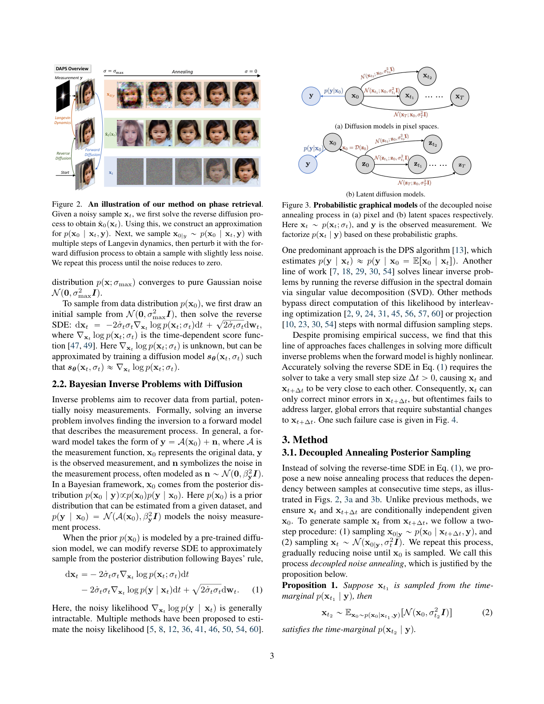

# DAPS｜Nature Reader 附加读本

原始出处：[arxiv:2407.01521](https://arxiv.org/abs/2407.01521)；首发 **2024 年 7 月**；CVPR 2025；阅读归档 **2026 年 10 月**。源格式：`pdf-text`，并与官方 HTML 对照。

**范围说明：**这是中文为主、保留关键英文术语的 source-grounded 主题精读，不是全文逐段翻译。Original 栏是英文释义而非逐字长引；参考文献和全部附录未逐段翻译。PDF 共 37 页，正文和补充材料均可提取；公式和关键图表使用原页裁剪。

## 阅读导航
- [S001 · 摘要与问题](#S001)，p.1
- [S002 · 为什么普通后验采样会卡住](#S002)，p.3
- [S003 · DAPS 的核心构造](#S003)，p.3
- [S004 · 后验采样与 Langevin 更新](#S004)，p.3
- [S005 · 工程近似与代价](#S005)，p.3
- [S006 · 主要实验回答什么](#S006)，p.4
- [S007 · 多解与可见证据的边界](#S007)，p.5
- [S008 · 讨论、贡献与限制](#S008)，p.5

## 公式索引

- [E001 · Eq.(2)](#E001)，p.3
- [E002 · Eq.(3)](#E002)，p.3
- [E003 · Eq.(4)](#E003)，p.3
- [E004 · Eq.(7)](#E004)，p.3

## 摘要与问题

**Source:** p.1 S001

**Original:** [English paraphrase, not a quotation] The paper studies Bayesian inverse problems with a learned diffusion prior and argues that tightly coupled denoising steps can fail on nonlinear measurements.

**中文:** 论文研究带学习型扩散先验的贝叶斯逆问题，并指出连续紧耦合的去噪步骤在非线性观测下可能失败。

**解读与边界：** 论文事实：摘要和引言把问题定位为复杂非线性测量中的全局错误修正。

## 为什么普通后验采样会卡住

**Source:** p.3 S002

**Original:** [English paraphrase, not a quotation] Small reverse-diffusion steps keep consecutive samples close, so a wrong early mode can be corrected only locally.

**中文:** 反向扩散的小步更新使相邻样本很接近，因此早期选错的模态只能被局部修正，难以跨越到另一个全局解。

**解读与边界：** 基于证据的解释：这是采样路径的局部性问题，不是简单的网络容量不足。

## DAPS 的核心构造

**Source:** p.3 S003

**Original:** [English paraphrase, not a quotation] DAPS samples a measurement-conditioned time marginal at each noise level instead of forcing a Markov-like small step from the preceding sample.

**中文:** DAPS 在每个噪声水平直接近似采样受观测条件约束的时间边缘分布，而不是强迫从前一步做很小的马尔可夫式移动。

**解读与边界：** 论文事实：作者用 decoupled noise annealing 解耦相邻时间样本，并逐步把噪声降到零。

## 后验采样与 Langevin 更新

**Source:** p.3 S004

**Original:** [English paraphrase, not a quotation] The conditional clean sample is approximated with a prior term and a measurement likelihood term, then Langevin dynamics explores this unnormalized posterior.

**中文:** 先用先验项和观测似然项构造干净样本的条件分布，再用 Langevin 动力学在这个未归一化后验中探索。

**解读与边界：** 论文事实：式(3)(4)给出条件分解与 Langevin 更新；实际实现采用条件高斯近似。

## 工程近似与代价

**Source:** p.3 S005

**Original:** [English paraphrase, not a quotation] A Gaussian approximation is cheaper than repeatedly evaluating the diffusion score, with a reported 6–7x speed advantage and a small task-dependent quality drop.

**中文:** 高斯近似比反复调用扩散 score 便宜；作者报告其速度约快 6–7 倍，但质量有依任务而定的小幅下降。

**解读与边界：** 论文事实：表3比较了高斯近似与 diffusion-score；不能把近似质量写成理论无损。

## 主要实验回答什么

**Source:** p.4 S006

**Original:** [English paraphrase, not a quotation] On FFHQ, DAPS reports 30.72 dB PSNR for phase retrieval and 27.12 dB for HDR, and the paper reports 31.49 dB for a high-resolution latent experiment.

**中文:** 在 FFHQ 上，DAPS 报告 phase retrieval 的 PSNR 为 30.72 dB、HDR 为 27.12 dB；高分辨率 latent 实验报告 31.49 dB。

**解读与边界：** 论文事实：这些是作者报告的任务结果，未在本机独立复现；不同任务和配置不能混算。

## 多解与可见证据的边界

**Source:** p.5 S007

**Original:** [English paraphrase, not a quotation] DAPS produces diverse samples for sparse measurements, but a posterior sample is only a plausible explanation under the prior and measurement model.

**中文:** 对信息稀疏的观测，DAPS 可以产生多样样本；但后验样本只是满足先验和观测模型的合理解释。

**解读与边界：** 迁移推断：对隐藏形状，这正好提示需要维护多个候选，而不能把最漂亮的单个结果当真实背面。

## 讨论、贡献与限制

**Source:** p.5 S008

**Original:** [English paraphrase, not a quotation] The contribution is a decoupled posterior-sampling path for nonlinear inverse problems; it depends on a usable forward operator and a prior that covers the target distribution.

**中文:** 贡献是为非线性逆问题提供解耦的后验采样路径；它依赖可用的前向算子以及覆盖目标分布的先验。

**解读与边界：** 证据边界：原文没有做 amodal mask、完整物体或三维隐藏表面的实验；迁移到这些任务属于研究假设。

**Source:** p.3 E001 · Eq. (2)

$$
\mathbf{x}_{t_2}\sim \mathbb{E}_{\mathbf{x}_0\sim p(\mathbf{x}_0\mid\mathbf{x}_{t_1},\mathbf{y})}[\mathcal{N}(\mathbf{x}_{t_2};\mathbf{x}_0,\sigma_{t_2}^{2}\mathbf{I})]
$$

**中文说明：** 从一个时间边缘到另一个噪声水平；条件分布的近似质量决定实际偏差。

**Source:** p.3 E002 · Eq. (3)

$$
p(\mathbf{x}_0\mid\mathbf{x}_t,\mathbf{y})\propto p(\mathbf{x}_0\mid\mathbf{x}_t)p(\mathbf{y}\mid\mathbf{x}_0)
$$

**中文说明：** 把先验条件项和观测似然项相乘；非线性观测由似然梯度进入。

**Source:** p.3 E003 · Eq. (4)

$$
\mathbf{x}_0^{(j+1)}=\mathbf{x}_0^{(j)}+\eta\nabla_{\mathbf{x}_0^{(j)}}\log p(\mathbf{x}_0^{(j)}\mid\mathbf{x}_t)+\eta\nabla_{\mathbf{x}_0^{(j)}}\log p(\mathbf{y}\mid\mathbf{x}_0^{(j)})+\sqrt{2\eta}\boldsymbol{\epsilon}_j
$$

**中文说明：** Langevin 在条件后验中探索；步长与迭代次数控制近似程度和成本。

**Source:** p.3 E004 · Eq. (7)

$$
\mathbf{x}_0^{(j+1)}=\mathbf{x}_0^{(j)}-\eta\nabla_{\mathbf{x}_0^{(j)}}\frac{\|\mathbf{x}_0^{(j)}-\hat{\mathbf{x}}_0(\mathbf{x}_t)\|^2}{2r_t^2}-\eta\nabla_{\mathbf{x}_0^{(j)}}\frac{\|\mathcal{A}(\mathbf{x}_0^{(j)})-\mathbf{y}\|^2}{2\beta_{\mathbf y}^2}+\sqrt{2\eta}\boldsymbol{\epsilon}_j
$$

**中文说明：** 实际高斯近似下的先验恢复项与数据一致性项。

## 术语表

| English | 中文 | 作用与边界 |
|---|---|---|
| posterior sampling | 后验采样 | 从观测和先验共同支持的解分布取样，不等于直接找到唯一真值 |
| forward operator | 前向算子 | 从候选完整信号生成观测的过程；迁移到遮挡需显式建模可见性与投影 |
| decoupled annealing | 解耦退火 | 降低相邻采样点依赖，允许跨越错误模态；增加计算和近似误差 |
| measurement likelihood | 观测似然 | 约束候选解释能否产生输入观测，不提供未观测区域的直接证据 |
| Langevin dynamics | Langevin 动力学 | 用梯度和噪声探索未归一化后验；步长不足会混合慢，步长过大会偏离 |

## 证据边界与待解决问题

**论文原文事实**是带页码的算法、表格和作者实验；**基于证据的解释**是对机制的因果拆解；**我们的迁移推断**见精读长文中的 ARIS ideas。未运行模型，没有把作者结果写成独立复现。
