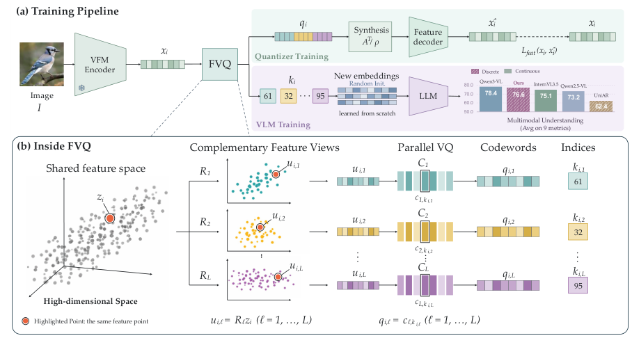
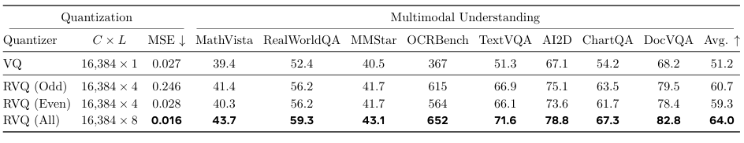
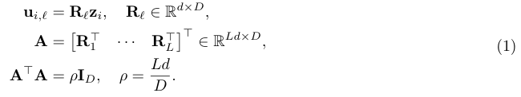
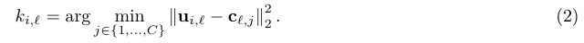
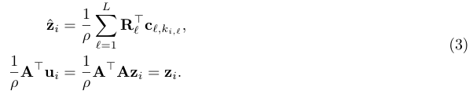

# FVQ｜Nature Reader 附加读本

原始出处：[arxiv:2610.37662](https://arxiv.org/abs/2610.37662)；首发 2026 年 10 月；阅读归档 2026 年 10 月。源格式：`pdf-text`，并与官方 HTML 对照。

**范围说明：**这是用户所需的结构化主题精读，覆盖摘要、引言、方法、结果、讨论、关键图表、公式与术语；不是全文逐段译本。下方 Original 栏明确使用英文释义，不是伪装成原文的逐字引文。中文逐块对应英文释义，补充分析另外标注。PDF 所有页面已提取，选定图和公式有原图裁剪；未逐段翻译参考文献及全部附录。

全文 PDF 共 23 页；阅读版本 `2610.37662v1`。页码均为 PDF 页序。没有扫描页；小图中文字若裁剪后仍不清，回到原 PDF 核验。

## 阅读导航

- [S001 · 摘要：量化误差能代表理解吗](#S001)，p.1
- [S002 · 引言与问题：名义容量和有效信息](#S002)，p.3
- [S003 · 方法：训练时重建与下游读ID](#S003)，p.5
- [S004 · 结果：MSE反例与共享配置](#S004)，p.4
- [S005 · 训练配方与工业实验](#S005)，p.7
- [S006 · 讨论、数学边界与三维问题](#S006)，p.17

## 公式索引

- [E001 · Eq.(1)](#E001)，p.6
- [E002 · Eq.(2)](#E002)，p.6
- [E003 · Eq.(3)](#E003)，p.6

## 摘要：量化误差能代表理解吗

**Source:** p.1 S001；见对应章节/表格。

**Original:** [English paraphrase, not a quotation] The paper studies semantic fidelity using multimodal understanding and finds that reconstruction error does not reliably rank downstream performance.

**中文:** 论文用多模态理解代理语义保真，发现特征重建误差不能可靠排序下游理解表现。

**解读与边界：** 【证据边界】语义保真在这里是操作性代理，不覆盖全部几何、时序或不可见结构。

## 引言与问题：名义容量和有效信息

**Source:** p.3 S002；见对应章节/表格。

**Original:** [English paraphrase, not a quotation] Adding codebooks can increase nominal capacity while their inputs become less informative. FVQ provides fixed-dimensional dense views to parallel codebooks.

**中文:** 增加码本会提高名义容量，但各码本输入可能越来越缺信息。FVQ向并行码本提供固定维度的稠密views。

**解读与边界：** 【基于证据的解释】新增参数和新增任务信息不同；并行运算不等于统计独立。

## 方法：训练时重建与下游读ID

**Source:** p.5 S003；见对应章节/表格。

**Original:** [English paraphrase, not a quotation] A frozen visual encoder feeds projections and quantizers. Tokenizer training reconstructs features; later multimodal training consumes IDs through newly learned embeddings.

**中文:** 冻结视觉编码器提供特征，经投影与量化得到ID。tokenizer训练重建特征；后续多模态模型通过新学embeddings读取ID。

**解读与边界：** 【论文原文事实】下游不读取重建特征。MSE和问答信息不等价的关键接口差异在此。

### 图表 F001 · Fig.3: tokenizer and multimodal training use different paths

**Source:** p.5；**Placed near:** S003。

**Original caption:** [English paraphrase] Fig.3: tokenizer and multimodal training use different paths

**中文图注：** 上：tokenizer重建支路与VLM读ID支路；下：多个稠密投影与并行码本。

**Reading note:** VLM路径经new embeddings进入LLM；不要把图中的feature decoder当下游视觉接口。

## 结果：MSE反例与共享配置

**Source:** p.4 S004；见对应章节/表格。

**Original:** [English paraphrase, not a quotation] The odd-group residual representation has higher MSE than single-codebook VQ but stronger understanding. Sixteen-codebook FVQ reaches a higher eight-benchmark average than the continuous baseline.

**中文:** RVQ奇数组合的MSE比单VQ高，理解均值却更好；16码本FVQ在八项平均上接近并超过所列连续基线。

**解读与边界：** 【论文原文事实】Table1:0.246/60.7 对0.027/51.2。Table2在p.8:65.3对64.6；MMStar和OCR仍较低，不是逐项无损。

### 图表 F002 · Table1: feature MSE versus understanding

**Source:** p.4；**Placed near:** S004。

**Original caption:** [English paraphrase] Table1: feature MSE versus understanding

**中文图注：** Table1展示更大MSE可以对应更高理解均值；OCRBench除10后参与平均。

**Reading note:** 这是具体配置的反例，不能反推增加误差会普遍提高理解。

## 训练配方与工业实验

**Source:** p.7 S005；见对应章节/表格。

**Original:** [English paraphrase, not a quotation] Industrial training uses four large stages. Nine-metric relative gains over discrete competitors and eight-metric controlled averages are separate comparisons.

**中文:** 工业训练有四个大规模阶段；对离散竞争者的九指标相对增幅，与受控实验的八指标均值是两种比较。

**解读与边界：** 【论文原文事实】四阶段100B/10B/60B/30B tokens。代码的runtime YAML为示例，不能承诺一周复现工业主结果。

## 讨论、数学边界与三维问题

**Source:** p.17 S006；见对应章节/表格。

**Original:** [English paraphrase, not a quotation] Tight-frame synthesis is exact before quantization. It does not prove that nearest-codeword replacement preserves every task-relevant distinction.

**中文:** tight-frame合成在量化前可精确恢复；这不证明最近码字替换保留所有任务相关区分。

**解读与边界：** 【我们的迁移推断】需检查几何敏感方向、跨视角对应和unknown区域。teacher未编码的背面区分，不会由确定性量化创造。

## 关键公式与变量

**Source:** p.6 E001 · Eq. (1)

$$
\begin{aligned}\mathbf{u}_{i,\ell}&=\mathbf{R}_{\ell}\mathbf{z}_i,\quad \mathbf{R}_{\ell}\in\mathbb{R}^{d\times D},\\\mathbf{A}&=\begin{bmatrix}\mathbf{R}_{1}^{\top}&\cdots&\mathbf{R}_{L}^{\top}\end{bmatrix}^{\top}\in\mathbb{R}^{Ld\times D},\\\mathbf{A}^{\top}\mathbf{A}&=\rho\mathbf{I}_D,\quad\rho=\frac{Ld}{D}.\end{aligned}
$$

**中文说明：** $D$是投影特征维度，$d$是每个view维度，$L$为码本组数。整体保能量条件作用在量化前；QR构造需要$Ld\ge D$。

**Source:** p.6 E002 · Eq. (2)

$$
k_{i,\ell}=\arg\min_{j\in\{1,\ldots,C\}}\left\|\mathbf{u}_{i,\ell}-\mathbf{c}_{\ell,j}\right\|_2^2
$$

**中文说明：** $C$是每个码本的entry数，$k$是选定ID，$c$为codeword。名义预算$L\log_2 C$不等于实测熵或任务互信息。

**Source:** p.6 E003 · Eq. (3)

$$
\begin{aligned}\hat{\mathbf z}_i&=\frac1\rho\sum_{\ell=1}^{L}\mathbf R_\ell^\top\mathbf c_{\ell,k_{i,\ell}},\\\frac1\rho\mathbf A^\top\mathbf u_i&=\frac1\rho\mathbf A^\top\mathbf A\mathbf z_i=\mathbf z_i.\end{aligned}
$$

**中文说明：** 第一行使用量化码字，仍有误差；第二行使用量化前views，所以可精确恢复。不能跨越这两种条件宣称量化后无损。

## 术语表

| 英文 | 中文 | 作用与边界 |
|---|---|---|
| tight frame | 紧框架 | 冗余线性测量整体各向同性，不保证量化后可逆 |
| nominal bit budget | 名义比特预算 | 码本组合上界；不等于熵或独立有效信息 |
| semantic fidelity | 语义保真 | 本文以理解基准代理，几何迁移须另验 |
| commitment | 承诺约束 | 稳定编码结果与所选码字的关系 |

## 证据标签与尚未解决的问题

**论文原文事实**是上面带页码的设计、表格与作者设置；**基于证据的解释**是对机制因果作用的拆解；**我们提出的研究假设**见同目录精读长文中的三项 ARIS idea。没有执行实验，也没有把相关工作检索等同新颖性证明。

[精读长文与完整 ARIS ideas](../fvq.md) · [每日六篇笔记](../../../2026-10-28.md) · [source_map.json](source_map.json) · [翻译与提取说明](translation_notes.md)
