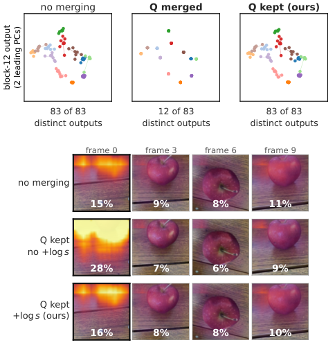
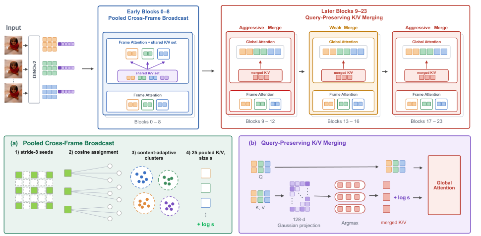
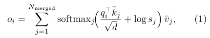
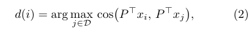

# GPA-VGGT｜Nature Reader 附加读本

原始出处：[arxiv:2610.37000](https://arxiv.org/abs/2610.37000)；首发 2026 年 10 月；阅读归档 2026 年 10 月。源格式：`pdf-text`，并与官方 HTML 对照。

**范围说明：**这是用户所需的结构化主题精读，覆盖摘要、引言、方法、结果、讨论、关键图表、公式与术语；不是全文逐段译本。下方 Original 栏明确使用英文释义，不是伪装成原文的逐字引文。中文逐块对应英文释义，补充分析另外标注。PDF 所有页面已提取，选定图和公式有原图裁剪；未逐段翻译参考文献及全部附录。

全文 PDF 共 16 页；阅读版本 `2610.37000v1`。页码均为 PDF 页序。没有扫描页；小图中文字若裁剪后仍不清，回到原 PDF 核验。

## 阅读导航

- [S001 · 摘要：保住几何的加速](#S001)，p.1
- [S002 · 引言与相关工作：为什么通用合并不够](#S002)，p.3
- [S003 · 方法：早期共享与后期保 query](#S003)，p.5
- [S004 · 结果：准确率与端到端时间](#S004)，p.8
- [S005 · 补充实验：峰值显存和机制消融](#S005)，p.10
- [S006 · 讨论与未解决问题](#S006)，p.8

## 摘要：保住几何的加速

**Source:** p.1 S001；见对应章节/表格。

**Original:** [English paraphrase, not a quotation] GPA-VGGT accelerates a pretrained geometry transformer without additional training by preserving queries and compressing context selectively.

**中文:** GPA-VGGT 不额外训练，保留所有 query，并选择性压缩被查询的上下文，减少几何 Transformer 的推理时间。

**解读与边界：** 【论文原文事实】目标是少损伤既有几何能力；【边界】不新增隐藏表面监督。

## 引言与相关工作：为什么通用合并不够

**Source:** p.3 S002；见对应章节/表格。

**Original:** [English paraphrase, not a quotation] Merging queries ties outputs of distinct locations. Omitting group sizes also redistributes attention, so dense geometry can degrade through different mechanisms.

**中文:** 合并 query 会让不同位置共享输出；省略组大小又会重新分配注意力。两条路径都能损伤稠密几何。

**解读与边界：** 【基于证据的解释】位置身份、上下文内容和证据计数需要分别保护。Fig.2展示83个输出被合为12种，不能靠复制恢复差异。

### 图表 F001 · Fig.2: output diversity and attention mass

**Source:** p.3；**Placed near:** S002。

**Original caption:** [English paraphrase] Fig.2: output diversity and attention mass

**中文图注：** 上：是否合并query影响输出多样性；下：log-size补偿影响各帧的注意力分配。

**Reading note:** 散点是输出投影，颜色/位置对应不同token；这不是三维真值散点图。

## 方法：早期共享与后期保 query

**Source:** p.5 S003；见对应章节/表格。

**Original:** [English paraphrase, not a quotation] Early blocks use frame attention with shared pooled context. Later blocks merge keys and values, retain every query, and reduce merging in sensitive middle blocks.

**中文:** 早期层使用帧内 attention 与共享 pooled context；后期层只合并 keys/values，保留 query，并对敏感中间层减少合并。

**解读与边界：** 【论文原文事实】0–8块共享；9–23块保query；13–16块合并率0.2，其余相关块0.9。匹配投影128维不等于主干输出降维。

### 图表 F002 · Fig.4: architecture and merging pathways

**Source:** p.5；**Placed near:** S003。

**Original caption:** [English paraphrase] Fig.4: architecture and merging pathways

**中文图注：** GPA-VGGT整体结构：早期共享跨帧K/V；后期保query、合并K/V并加log-size。

**Reading note:** 敏感中间块使用较弱压缩；图中不同路径不能合称为统一token裁剪。

## 结果：准确率与端到端时间

**Source:** p.8 S004；见对应章节/表格。

**Original:** [English paraphrase, not a quotation] At two hundred frames runtime decreases from 86.78 to 33.65 seconds. Accuracy remains close to the baseline under the reported evaluation settings.

**中文:** 200帧时间从86.78秒降到33.65秒；在论文评测设置下精度接近原模型。

**解读与边界：** 【论文原文事实】Table1 CO3D AUC@3为57.49→56.94；不能把不同帧数/采样表格拼接。短序列仅0.84→0.78秒。

## 补充实验：峰值显存和机制消融

**Source:** p.10 S005；见对应章节/表格。

**Original:** [English paraphrase, not a quotation] Peak memory remains almost unchanged because full-length feed-forward activations remain. Separate ablations support both query preservation and size correction.

**中文:** 峰值显存几乎不变，因为全长FFN激活仍保留；组合消融支持保query和大小补偿各自的作用。

**解读与边界：** 【论文原文事实】TableS1，500帧32.67→32.69GiB。TableS3在p.11；双机制56.94，无机制49.93。少算attention不自动解决内存瓶颈。

## 讨论与未解决问题

**Source:** p.8 S006；见对应章节/表格。

**Original:** [English paraphrase, not a quotation] The evidence concerns pose and visible-surface geometry. It does not establish reconstruction of unobserved complete shapes.

**中文:** 证据主要覆盖位姿和可见表面几何，未建立对未观测完整形状的恢复能力。

**解读与边界：** 【我们的迁移推断】可见性分组压缩可能适合重建；三维amodal还需完整形状先验、hidden queries及新视角否证。组内logit分散造成剩余误差，见长文独立推导。

## 关键公式与变量

**Source:** p.4 E001 · Eq. (1)

$$
o_i=\sum_{j=1}^{N_{\mathrm{merged}}}\operatorname{softmax}_{j}\left(\frac{q_i^\top\bar{k}_j}{\sqrt d}+\log s_j\right)\bar{v}_j
$$

**中文说明：** $q_i$为每个位置独立query；$s_j$为组大小。只有组内keys相同时，与原attention精确相等；不等于任意合并无损。

**Source:** p.5 E002 · Eq. (2)

$$
d(i)=\arg\max_{j\in\mathcal{D}}\cos(P^\top x_i,P^\top x_j)
$$

**中文说明：** $P$为高斯投影，$\mathcal D$为候选目的集合，$x_i$为匹配特征。128维匹配更快，但近邻决策并非全部相同。

## 术语表

| 英文 | 中文 | 作用与边界 |
|---|---|---|
| query preservation | 保留查询 | 保住输出身份，不能恢复已抹掉的K/V内容 |
| token-size correction | token大小补偿 | softmax恢复组计数，不保证独立证据 |
| pooled broadcast | 池化广播 | 共享跨帧低成本上下文 |
| sensitivity | 扰动敏感性 | 不是分类敏感度；指合并后表征偏差 |

## 证据标签与尚未解决的问题

**论文原文事实**是上面带页码的设计、表格与作者设置；**基于证据的解释**是对机制因果作用的拆解；**我们提出的研究假设**见同目录精读长文中的三项 ARIS idea。没有执行实验，也没有把相关工作检索等同新颖性证明。

[精读长文与完整 ARIS ideas](../gpa-vggt.md) · [每日六篇笔记](../../../2026-10-27.md) · [source_map.json](source_map.json) · [翻译与提取说明](translation_notes.md)
