# OccJEPA｜Nature Reader 源文精读结果

来源格式：**pdf-text**。论文：Genpei Zhang，arXiv `2610.29061v1`，2026年10月；20页PDF（主文p.1–8、参考文献p.9–10、补充p.11–20）。[论文](https://arxiv.org/abs/2610.29061) · [固定PDF](https://arxiv.org/pdf/2610.29061v1) · [精读长文](../occjepa.md) · [源地图](source_map.json) · [不确定性记录](translation_notes.md)。

这是**按论文结构组织的中文源文释读，辅以极短英文术语对照，不是全文逐段翻译**。所有页已提取文本，但未逐图视觉审查全部补充材料；未核验部分保留边界，不臆补。页码均是PDF物理页。论文原文事实、作者解释与我们的迁移推断分别标记。

## 页码导航

p.1摘要/问题；p.2相关工作与任务；p.3框架、预训练、掩码与特征补全；p.4head/训练/重裁剪；p.5共同帧及真实框实验；p.6定性结果；p.7合成实验与特征可视化；p.8消融/开销/结论；p.9–10参考文献；p.11–17训练、实现与进一步分析；p.18成本、遮挡分组与时序；p.19–20补充定性示例。后两页仅文本检索，图中边界未逐一核验。

## 摘要：贡献是预测表示，而不是生成像素

**Source:** p.1，摘要；p.8，结论。

**Original:** “latent completion”

**中文:** **潜在特征补全**。作者不是先生成没有遮挡物的视频，再分割目标，而是删除低目标覆盖token，利用预训练predictor提出特征，再直接输出amodal mask。

【论文原文事实】真实框、合成像素实验及初始化对照支持这个路线；【证据解释】纹理生成不是最终任务所必需，省掉它可减少成本；【证据边界】合理特征不是隐藏实例的真实测量。

## 引言/相关工作：把两个问题对接

**Source:** p.1–3，§1–3.2。

**Original:** “occlusion as masking”

**中文:** **把遮挡改写为缺失输入**。视频预训练预测人为删掉的位置；amodal要推断被别的物体盖住的目标。二者共享“证据不完整”的结构，但真实遮挡不是随机缺失，删掉的还包含背景，不能直接当作完全同分布。

【论文原文事实】V-JEPA2.1是先验来源，Diffusion-VAS是直接比较路线，VideoMAE是替代补全模块。【证据解释】保留predictor的价值由随机初始化对照检验，不能仅靠世界模型这一名称证明。

### 图2：双支路框架

**Source:** p.3，Fig.2；Placed near: S002。

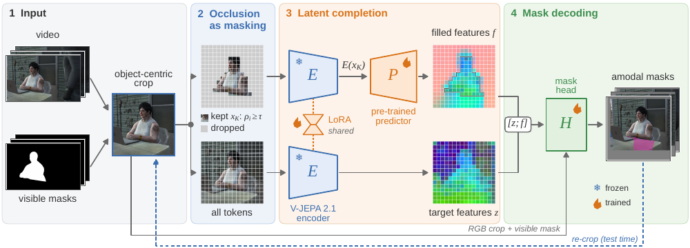

**中文图注释读:** 可见mask决定保留集，完整clip提供$z$，保留token经predictor形成$f$，head合读两者与RGB/mask。雪花/火焰对应冻结与训练；encoder仅LoRA适配，predictor要微调。蓝色回路是测试时再裁剪。

**Reading note:** 完整支路仍看见遮挡物；这张图不支持“遮挡物完全被消除”。

## 方法与公式：预训练和下游训练分开读

**Source:** p.3–4，§3.2–3.4。

### E001｜原式(1)，p.3：预训练背景

$$
\min_{E,P}\left\|P(E(x_K),D)-\operatorname{sg}(\bar E(x))_D\right\|_1.
$$

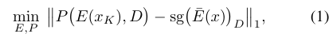

【论文原文事实】$K/D$是保留/删除位置，$\bar E$为目标encoder，sg阻断梯度。比较的是特征而非RGB。【作者解释】L1理想解对应条件中位数，能概括常见延续；【证据边界】不是严格三维后验，也不是下游另外添加的损失。

### E002｜原式(2)，p.3：裁剪支持域

$$
s_t=\min\!\left(\max\!\left(2\max(h_t,w_t),s_{\min}\right),s_{\max}\right).
$$

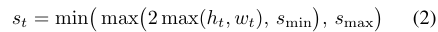

【论文原文事实】围绕visible框扩张、缩到256×256，24帧、2×16×16 tubelet，共12×16×16 token。【证据解释】扩框减截断，但同分辨率下也压缩细节。

### E003｜原式(3)，p.3：覆盖率

$$
\rho_i=\frac{1}{|V_i|}\sum_{p\in V_i}\tilde m(p),\qquad
K=\{i:\rho_i\geq\tau\},\quad \tau=0.25.
$$

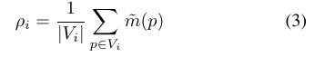

【论文原文事实】不足阈值的位置删除，包括隐藏目标、遮挡物和背景；补充§A，p.11另有全删时保留覆盖率最高一个token的保底，避免空上下文，但不保证证据充分。【我们的推断】网格相位和碎片化可能在可见面积不变时改变证据拓扑；这是待实验假设，不是论文既有消融。

### E004｜原式(4)，p.3：推断特征

$$
\hat z_D=P(E(x_K),D),\qquad
f_i=\begin{cases}\hat z_i,&i\in D,\\z_i,&i\in K.\end{cases}
$$

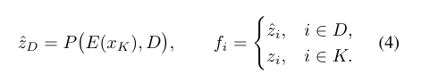

【论文原文事实】另有完整clip特征$z=\operatorname{LN}(E(x))$；head合读$[z;f]$。预训练ViT-G encoder48blocks、1.85B，predictor24blocks，四深度特征拼接。predictor微调；encoder最后12blocks加rank16 LoRA。

### E005｜原式(5)，p.4：可见部分硬保留

$$
\hat a_t=\Pi_t(\ell_t>0)\lor m_t.
$$

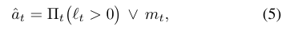

【论文原文事实】$\Pi_t$贴回原图；后窗覆盖前窗。【证据解释】输入可见mask假阳性会被OR保留；后续不能仅靠负logit删除。跨窗覆盖也不是全视频联合优化。

### E006｜原式(6)，p.4：实际下游目标

$$
\mathcal L=\operatorname{BCE}(\ell,a)+1-
\frac{2\sum ya+1}{\sum y+\sum a+1},\qquad y=\sigma(\ell).
$$

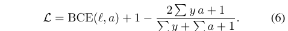

【论文原文事实】amodal监督，50/50 SAIL-VOS与MOVi-D，6000steps、batch8。第二遍用首轮完整框重裁，无新参数，成本翻倍。【证据边界】损失未直接约束三维深度、自由空间或时序运动一致性。

## 公式索引

[E001](#E001) · [E002](#E002) · [E003](#E003) · [E004](#E004) · [E005](#E005) · [E006](#E006)。

## 结果：分母、初始化和真实标注层级

**Source:** p.4–8，Table1–6；p.18，TableS13。

**Original:** “fixed-frame” / “Temporal stability”

**中文:** **共同帧计分 / 时序稳定性**。必须先确定同一批帧、同一种标签和同一种输入，再谈谁更好。

### 表2：共同遮挡帧

**Source:** p.5，Table2；Placed near: S004。

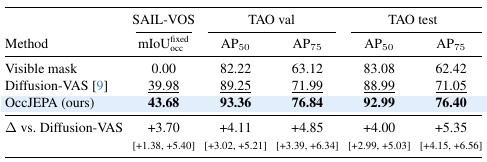

【论文原文事实】固定83,245个SAIL遮挡帧、miss记零：39.98→43.68，差+3.70，95%CI[+1.38,+5.40]。TAO test AP50 88.99→92.99。

**Reading note:** 官方Table1遮挡IoU是55.12 vs52.09，不能隐藏；补充§B，p.12按5×5腐蚀后隐藏IoU至少$10^{-6}$的kept子集计分，不仅漏补，完全错位的补全也可能被排除。fixed共同帧保留零分。TAO仅框标注，其AP50是框IoU越阈值帧比例，不是未加说明的COCO排序AP。

### 表4：预训练与同结构随机初始化

**Source:** p.8，Table4；Placed near: T001。

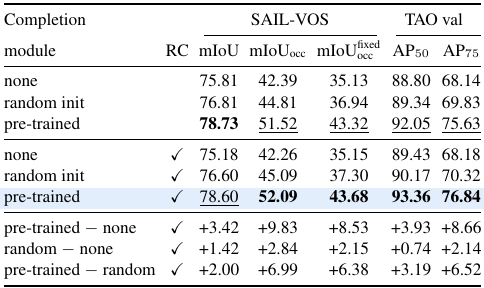

【论文原文事实】带RC时无predictor35.15、随机37.30、预训练43.68；TAOval AP50分别89.43/90.17/93.36。

**Reading note:** 支持预训练信息价值；不支持无条件普遍75%因果分配。MOVi cropped隐藏IoU有不利结果，详见长文，不把whole-frame优势替代所有设置。

### 表6：系统效率比较

**Source:** p.8，Table6；Placed near: T002。

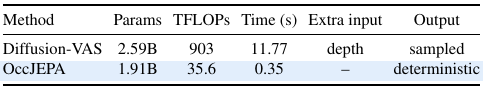

【论文原文事实】0.35秒/35.6TFLOPs vs11.77秒/903TFLOPs，同GPU，但输入帧数/分辨率/额外depth和迭代次数不同。

**Reading note:** 这是两套系统配置比较；24帧非因果clip不是在线单帧延迟。

### 表S13：不利的时序结果也必须保留

**Source:** p.18，TableS13；Placed near: T003。

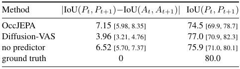

【论文原文事实】相邻mask IoU变化相对GT的偏差，越低越好：OccJEPA7.15、Diffusion-VAS3.96，无predictor6.52。95%CI见原表。

**Reading note:** 视频先验没有自动换来更稳定输出。补充p.17已给负对照：首帧对/其余帧对为OccJEPA7.99/7.11、基线4.11/3.96，不支持窗口拼接是主要差距来源。作者解释逐帧crop与逐帧目标，阈值跳变也是我们的候选；这些尚未完整干预分离，不能写成已定根因。

## 讨论与未解决问题

**Source:** p.6–8，§4.4–5；p.11–20补充。

【论文原文事实】特征可视化展示预测特征在目标区域延续；补充给出阈值、实现、成本、遮挡分组和失败示例。小遮挡组落后；TableS13稳定性落后。

【证据解释】PCA颜色延续只能支持表示线索，不是完整隐藏表面真值。永久不可见部位存在多解；模型给单一输出、监督给单个mask，不会自动表达歧义。

【我们的迁移推断】最可取的是保留实际与推断两类证据。迁移三维需新增相机/深度/对象坐标、observed/free/unknown、跨视角一致性及可撤销候选；这些不是本文已有能力。新的视角若能推翻旧预测，才更接近可信的三维amodal状态估计。

## 术语表

| 英文 | 中文直觉 | 在方法中的作用 | 最易失败场景 |
|---|---|---|---|
| JEPA | 预测缺失位置的抽象描述 | 特征先验，不画RGB | 同类别不同隐藏姿态 |
| Tubelet | 视频的小块压缩单元 | 控制token量、建立时空上下文 | 薄结构混进遮挡物 |
| LoRA | 小型低秩权重更新 | 让encoder适配分割而少训参数 | 不是零样本、仍受标注偏差 |
| Predictor | 对删除位置提出特征 | 搬运预训练预测知识 | 永久不可见、多解 |
| Re-crop | 按首轮预测重新取样 | 修复输入支持域截断 | 幻觉带偏、分辨率稀释 |
| Fixed-frame scoring | 同一批帧、漏报记零 | 减少选择性漏报偏差 | 单均值仍掩盖错误类型 |

## 证据边界与原文对照范围

全文20页文本提取成功；重点视觉核查p.2–8、p.18，原式1–6与图2/表2/4/6/S13已对照。参考文献未逐篇全文审计，补充p.19–20图像未逐一裁剪验证，未做全文双语翻译。代码已检查，但任务checkpoint的可下载地址未核实，没装依赖/没跑网络/没用GPU。外部检索Semantic Scholar返回429，不能称完整查新。原始下载与Zotero storage SHA256一致，实际附件已存在。
