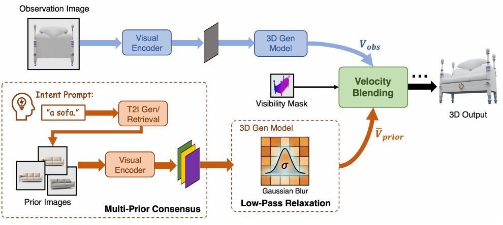
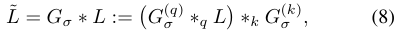
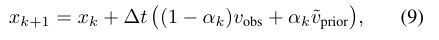
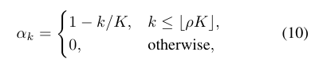
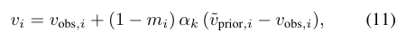
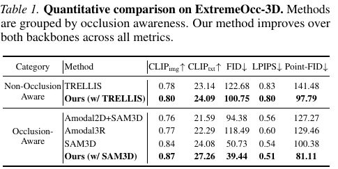
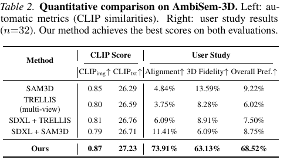
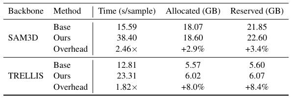
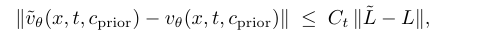

# RelaxFlow｜Nature Reader 源文定位读本

**范围：章节式源文阅读与关键公式/图表对照，不是全文逐段翻译。** 固定阅读[arXiv:2603.05425v2](https://arxiv.org/html/2603.05425v2)，PDF28页、2026-05-27版本，首个预印本月份2026-03；[正式ICML/PMLR记录](https://proceedings.mlr.press/v306/zhu26m.html)的当前直接抓取页码为PMLR306:166962–166989，会议引用月2026-07、页面`citation_publication_date`为2026-09-29；阅读归档2026年10月。会议月与页面发布日期分别保留，未逐页核对正式论文集PDF与v2。PDF已存Zotero `每日精读论文/2026/10`，条目`8SC9FOQH`、附件`TQBKESRF`。[独立精读长文](../relaxflow.md)保留完整研究分析与ARIS，本文不替代长文。

源格式为 **pdf-text**：28页均提取文本；p.3–8、18、25视觉核对。主体按原文摘要→引言/相关工作→方法→结果→讨论/附录走，短英文原文只用于对齐关键术语；其余为中文转述与解释，不能冒充全文翻译。所有补充图逐一核查、全部推导的严格证明复核、完整代码复现仍未完成，详见[处理说明](translation_notes.md)和[source map](source_map.json)。

## 章节与公式索引

- [S001 摘要与问题](#S001)：p.1–2。
- [S002 相关工作与信息缺口](#S002)：p.2–3。
- [S003 方法与图3](#S003)：p.3–7。
- [S004 结果与图表](#S004)：p.7–9、23、25。
- [S005 理论条件与失败](#S005)：p.13–18、26–28。
- [S006 阅读边界](#S006)：整篇。

## 公式索引

- [E001 原式(8)](#E001)：p.6，先验logit平滑。
- [E002 原式(9)](#E002)：p.6，共享状态速度融合。
- [E003 原式(10)](#E003)：p.6，早期截止门控。
- [E004 原式(11)](#E004)：p.7，可见性门控。
- [E005 附录A.4未编号不等式](#E005)：p.18，logit到速度的变化界。

## 摘要与引言

**Source:** p.1–2，摘要、§1，S001。

**Original:** “text-driven amodal 3D generation”

**中文:** “文字驱动的amodal三维生成”。【论文原文事实】同一照片有多个合法完整解释，用户用文字选择想要的解释，方法试图保持观测部分。原文将观测保真与提示遵循作为两个目标。

【基于证据的解释】“用户要沙发”是意图，不是对真实背面的测量。成像多对一时，加入意图选择一个模式与证明该模式是真实物体不同。摘要的强表述要带着后文理论假设与指标协议读。

## 相关工作与信息缺口

**Source:** p.2–3，§2–3.1，S002。

**Original:** “Observation Constraint”

**中文:** “观测约束”。【论文原文事实】已有图像到三维模型倾向观测驱动；二维编辑后转三维可能出现几何不一致；多个参考实例也不能简单当同实例多视角。作者把观测条件与用户语义条件分开表示。

【基于证据的解释】前者对该实例可见部分有较高证据权重；后者只表达类别/属性，参考图带的颜色与局部形状可能是干扰。深层矛盾是条件地位与控制粒度错配，不是少一个更强的backbone。

## 方法：先问每个分支有权改哪里

**Source:** p.3–7，§3–4，S003；F001对应p.5 Figure3。

**Original:** “Multi-Prior Consensus”

**中文:** “多先验共识”。【论文原文事实】从提示检索或生成多个参考图，用生成器原生视觉编码器编码后拼接tokens。先验和观测在同一latent上各预测速度，先验分支做logit平滑；时间门控前期加入语义、后期退出，可见性门控减少先验对可见体素的作用。

**Source:** p.5 Figure3；图像为原PDF裁图，以下为中文解读。

图3中文解读：照片→观测分支；提示→参考图片→视觉tokens→平滑后的先验分支；可见性mask调节两速度融合。图中的流程说明模块关系，不是独立证明每个箭头有效的实验。

**Source:** p.6 Eq.(8)，E001。公式经PDF视觉核对；乘积方向以原图为准。

$$
\widetilde L=G_\sigma*L:=\big(G_\sigma^{(q)}*_qL\big)*_kG_\sigma^{(k)}.
$$

【论文原文事实】对query和key序列轴做归一化高斯卷积，再softmax并乘value。$\sigma$控制平滑，观测分支attention不改。**中文说明：**减少尖锐局部匹配的影响，不等于在最终三维mesh上直接平滑几何。

**Source:** p.6 Eq.(9)，E002。

$$
x_{k+1}=x_k+\Delta t\big((1-\alpha_k)v_{\rm obs}+\alpha_k\widetilde v_{\rm prior}\big).
$$

$x_k$为共享latent、$\Delta t$步长；两分支求同状态的变化方向。中文说明：不是两条独立生成轨迹的mesh混合，而是每步更新前融合速度。

**Source:** p.6 Eq.(10)，E003。

$$
\alpha_k=\begin{cases}1-k/K,&k\le\lfloor\rho K\rfloor,\\0,&\text{otherwise}.\end{cases}
$$

$K$总步数、$\rho$截止比例。【基于证据的解释】早期挑模式、后期细化，旨在避免先验后期覆盖观测细节；这套粗细分工是否适合细部决定类别的物体，仍需反例测试。

**Source:** p.7 Eq.(11)，E004。

$$
v_i=v_{{\rm obs},i}+(1-m_i)\alpha_k(\widetilde v_{{\rm prior},i}-v_{{\rm obs},i}).
$$

$m_i$为soft visibility，可见时接近1，隐藏时更小。mask由backbone pose与z-buffer构造，TRELLIS无pose版本关闭mask。【基于证据的解释】估计可见性错就会分错权限；原式不是对最终观测像素的硬投影保证。

## 结果：分别核查语义、观测、几何与开销

**Source:** p.7–9 §5；p.23扩展结果；p.25 Table6，S004。

【论文原文事实】ExtremeOcc-3D 264例，遮挡率至少80%；AmbiSem-3D最初21例、多意图分支，32人偏好研究，附录扩展100例。ExtremeOcc的先验来自不同实例同类别；AmbiSem用Z-Image生成，比较方法共用先验。

**Source:** p.7 Table1。

中文解读：SAM3D到Ours，Point-FID100.38→81.11、CLIPtxt24.08→27.26、LPIPS.54→.51。三项观察不能合并为“每实例隐藏结构准确”。Point-FID在Point-E语义特征分布上计算；min-LPIPS允许选择较匹配视角，无法证明固定真实相机逐像素不变。

**Source:** p.8 Table2。

中文解读：总体偏好68.52%，是给定案例与候选方法中的人类选择。AmbiSem本来没有唯一三维真值；不能把偏好率改写成真实恢复率。去平滑和去mask的Point-FID退化支持组件效用，但没有独立测量本文所有根因解释。

**Source:** p.25 Table6。

中文解读：10例、A5000，SAM3D 15.59→38.40秒/例，TRELLIS12.81→23.31；显存增幅较温和，时间增幅明显。正文A40实验与该附录测时条件分开。先验检索/文生图全部端到端成本是否计入未明确，不能臆补。

## 理论、讨论与失败条件

**Source:** p.13–18附录A，p.26–28附录H，S005。

【论文原文事实】附录先假设语义信号低频、误差高频，讨论平滑降低语义误差；分布稳定性上界还依赖Lipschitz与代理偏差受控。附录H展示观测/先验矛盾时的概念融合失败。

**Source:** p.18 Appendix A.4，未编号末行，E005。

$$
\|\widetilde v_\theta(x,t,c_{\rm prior})-v_\theta(x,t,c_{\rm prior})\|
\le C_t\|\widetilde L-L\|.
$$

中文说明：若网络对logits足够平滑，logits改动可控制输出速度改动。这是扰动大小界；没有直接证明输出速度等于同一高斯滤波，更没有证明最终几何逐实例更准。【基于证据的解释】更紧Wasserstein上界也不等于两个真实误差已排序。谱假设若不成立、参考先验偏差增大，结论不能无条件使用。

## 术语表

| 英文规范名 | 中文 | 表示/推理中的作用 | 删除或失败会怎样 |
|---|---|---|---|
| amodal generation | 完整对象生成 | 在可见片段外补结构 | 无新观测时仍有多解 |
| observation fidelity | 观测保真 | 保持该实例可见证据 | 先验可覆盖测量 |
| semantic prior | 语义先验 | 选择隐藏解释 | 有偏先验会选错真实实例 |
| Multi-Prior Consensus | 多先验共识 | 拼接共同属性、稀释实例细节 | 共同偏差反而被放大 |
| low-pass relaxation | 低通松弛 | 平滑先验logits | 高频真信号也可能被抹 |
| visibility-aware fusion | 可见性感知融合 | 依可见性分配引导 | pose错时权限分错 |
| rectified flow | 整流流 | 从噪声到三维latent的速度 | 非真实物体运动 |
| Point-FID | 点特征分布距离 | 集合级语义比较 | 不能替代隐藏面/拓扑误差 |

## 阅读提示与证据边界

【论文原文事实】原文提供可控生成与基准、组件消融、失败图；本次源码可访问，PDF已导入，未运行模型。**【基于证据的解释】**迁移应保留“测得表面与先验补全不同权限”；多视角重建还要独立加入自由空间、跨视角与新增真实观测，才能让先验被推翻。

**【我们提出的研究假设】**优先做三个诊断：细拓扑是否被低通损坏、GT visibility能否修复观测漂移、新视角能否撤销错误隐藏候选。实验步骤与阳性/阴性/无信号解释详见独立长文。未把这些假设写成论文结论。
