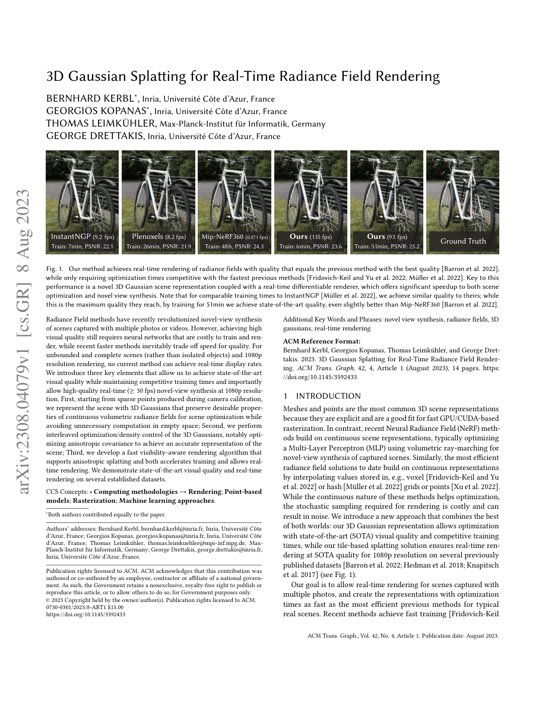
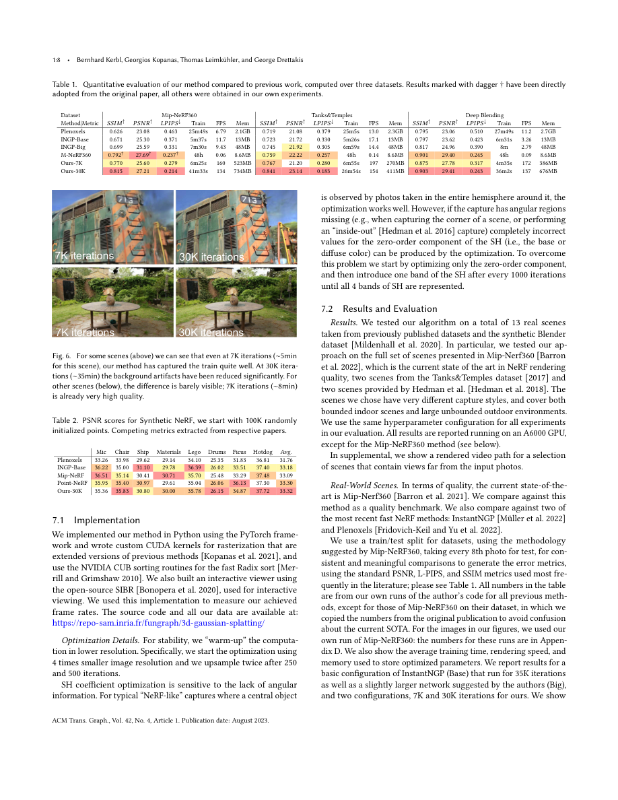
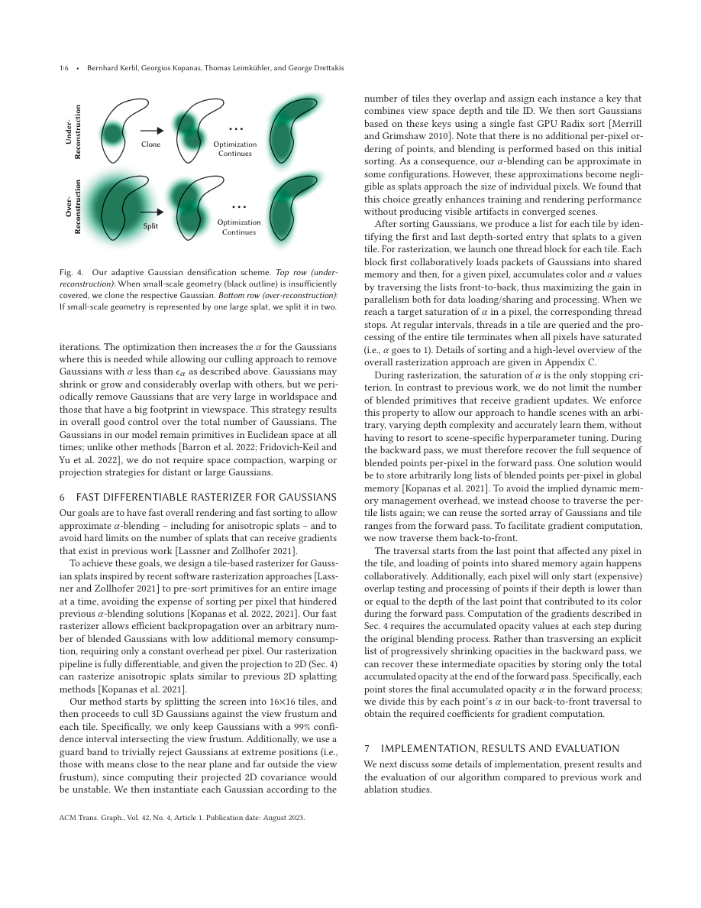
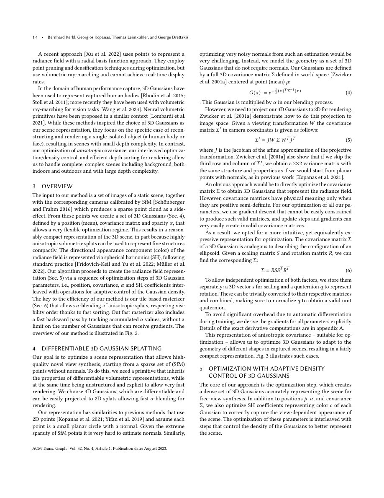

# 3D Gaussian Splatting｜Nature Reader 附加读本

原始出处：[arXiv:2308.04079](https://arxiv.org/abs/2308.04079)；正式发表：**ACM Transactions on Graphics 42(4)，2023 年 8 月**；阅读归档：**2026 年 11 月**。源格式：`pdf-text`，公式和关键图表与 PDF 页面裁剪对照。

**范围说明：**这是中文为主、保留关键英文术语的 source-grounded reader。`Original` 为英文释义而非长篇逐字引文；参考文献未逐段翻译。PDF 共 14 页，文本层完整；公式主要在图像层，因此对公式给出页码、裁剪图和保守解释。

## 阅读导航
- [S001 · 摘要与问题](#S001)，p.1
- [S002 · 相关工作为何不够](#S002)，p.2
- [S003 · 反向重建作者的思路](#S003)，p.2
- [S004 · 真实输入走 pipeline](#S004)，p.2
- [S005 · 公式与优化行为](#S005)，p.4
- [S006 · 关键图表与实验](#S006)，p.8
- [S007 · 真正留下的结论](#S007)，p.12
- [S008 · 讨论、限制与未解决问题](#S008)，p.12

## 公式索引

- [E001](#E001)
- [E002](#E002)
- [E003](#E003)
- [E004](#E004)

## 摘要与问题

**Source:** PDF p.1 · S001

**Original:** [English paraphrase, not a quotation] The paper targets the quality-speed gap in radiance-field rendering for complete scenes and 1080p novel views.

**中文:** 论文针对完整场景和 1080p 新视角渲染中的质量—速度鸿沟：NeRF 类方法质量高但训练/渲染昂贵，快速方法又牺牲质量。

**解读与边界：** 论文原文事实：作者把目标写成实时（至少 30 fps）新视角合成，同时保持接近当时 SOTA 的视觉质量。

## 相关工作为何不够

**Source:** PDF p.2 · S002

**Original:** [English paraphrase, not a quotation] Continuous radiance fields waste computation in empty space, while explicit point methods often require expensive geometry initialization.

**中文:** 连续辐射场在空空间中反复采样；显式点方法虽然快，却常依赖 MVS 或低质量点初始化。

**解读与边界：** 基于证据的解释：瓶颈不是单一网络层，而是表示、初始化和渲染器共同决定了每一条射线需要付出的计算量。

## 反向重建作者的思路

**Source:** PDF p.2 · S003

**Original:** [English paraphrase, not a quotation] The authors combine an explicit differentiable Gaussian representation, adaptive density control, and visibility-aware tile rasterization.

**中文:** 作者把问题拆成三件事：用可微显式 Gaussian 表示承载场景，用自适应密度控制调整容量，再用可见性感知的 tile rasterizer 快速合成。

**解读与边界：** 这是基于方法结构的思路重建，不是作者访谈记录。关键不是单独换成 Gaussian，而是让表示、优化和渲染共享同一稀疏结构。

## 真实输入走 pipeline

**Source:** PDF p.2 · S004

**Original:** [English paraphrase, not a quotation] Calibrated cameras and sparse SfM points initialize 3D Gaussians; optimization alternates photometric updates and cloning, splitting, or pruning.

**中文:** 输入是已标定相机和 SfM 稀疏点。每个点变成带位置、各向异性协方差、不透明度和视角颜色的 Gaussian；光度损失更新参数，密度控制周期性克隆、分裂或裁剪。

**解读与边界：** 例如三张房间照片只在正面看到柜子：3DGS 会把有梯度的可见区域拟合得很好，但未被任何射线触及的背面不会因为表示本身自动出现。

## 公式与优化行为

**Source:** PDF p.4 · S005

**Original:** [English paraphrase, not a quotation] A Gaussian is a spatial density with a covariance matrix; projected Gaussians are alpha-composited in visibility order and optimized against rendered images.

**中文:** Gaussian 用均值和协方差表达空间密度，投影后按深度/可见性排序，用 alpha compositing 形成像素；优化目标让渲染图接近训练照片，同时密度控制调节表示容量。

**解读与边界：** 论文中的公式在 PDF 图像层，本文用页面裁剪并给出保守释义；不把渲染损失写成几何真值损失。

## 关键图表与实验

**Source:** PDF p.8 · S006

**Original:** [English paraphrase, not a quotation] The headline comparison reports real-time rendering, with the paper showing 135 fps at about 23.6 PSNR for a fast setting and 93 fps at about 25.2 PSNR for a longer setting in the overview figure.

**中文:** 概览图报告了两种设置：约 6 分钟训练、135 fps、PSNR 23.6；以及约 51 分钟训练、93 fps、PSNR 25.2。论文还在多个公开数据集上报告质量与速度折中。

**解读与边界：** 这些是作者报告的设置，不是本机复现。图中 PSNR 与 fps 属于特定硬件、分辨率和数据协议，不能外推成任何设备上的固定速度。

## 真正留下的结论

**Source:** PDF p.12 · S007

**Original:** [English paraphrase, not a quotation] Explicit anisotropic Gaussians can make high-quality novel-view rendering practical, but the representation is optimized for explaining observed rays.

**中文:** 显式各向异性 Gaussian 能把高质量新视角合成变得实用；但它的主要监督仍来自已观测射线。

**解读与边界：** 这正是迁移边界：它强于“把观测几何快速拟合出来”，不等于它会识别从未被观测的完整实体。

## 讨论、限制与未解决问题

**Source:** PDF p.12 · S008

**Original:** [English paraphrase, not a quotation] The method does not by itself guarantee watertight geometry, semantic parts, or correct hidden surfaces.

**中文:** 3DGS 本身不保证 watertight 实体、语义部件、拓扑连接或被完全遮挡表面的正确性。

**解读与边界：** 当隐藏区域没有射线梯度时，增加 Gaussian 数量只增加可表达容量，不会增加事实证据；这不是训练不够久就能解决的普通欠拟合。

**Source:** PDF p.4 · E001

$$
\mathcal{G}(\mathbf{x})=\exp\left(-\frac{1}{2}(\mathbf{x}-\boldsymbol{\mu})^\top\boldsymbol{\Sigma}^{-1}(\mathbf{x}-\boldsymbol{\mu})\right)
$$

**中文说明：** Gaussian 由中心 μ 与协方差 Σ 定义；Σ 控制椭球方向和尺度。

**Source:** PDF p.4 · E002

$$
\boldsymbol{\Sigma}=\mathbf{R}\mathbf{S}\mathbf{S}^{\top}\mathbf{R}^{\top}
$$

**中文说明：** 用旋转 R 与尺度 S 参数化协方差，优化时保持正定结构而不直接更新任意矩阵。

**Source:** PDF p.8 · E003

$$
C(\mathbf{p})=\sum_{i=1}^{N}T_i\,\alpha_i\,\mathbf{c}_i,\qquad T_i=\prod_{j<i}(1-\alpha_j)
$$

**中文说明：** 像素颜色是按可见顺序的 alpha 合成；前方高不透明度会减少后方 Gaussian 对该像素的梯度。

**Source:** PDF p.6 · E004

$$
\mathcal{L}=(1-\lambda)\mathcal{L}_1+\lambda\,\mathcal{L}_{D\text{-}SSIM}
$$

**中文说明：** 光度目标结合 L1 与结构相似性；它约束渲染图，不能单独证明隐藏表面或拓扑正确。

## 关键图表

Figure 1 的可读结论是质量、训练时长和渲染速度存在明确折中：表示和 rasterizer 同时改变了优化与推理成本。图像裁剪来自 PDF p.1；数值以作者图注为准。

PDF p.4 的表示图说明 3D Gaussian 的中心、协方差、不透明度和视角颜色如何进入投影。它展示的是表示机制，不是隐藏几何真值。

## 术语表

| English | 中文 | 作用与边界 |
|---|---|---|
| 3D Gaussian | 三维高斯 | 用连续密度核近似场景局部；表达能力不等于语义或实体拓扑 |
| anisotropic covariance | 各向异性协方差 | 让核沿不同方向伸缩旋转，减少用大量球形点拟合斜面；强依赖稳定投影梯度 |
| density control | 密度控制 | 按梯度/尺度克隆、分裂、裁剪 Gaussian；能调容量，不能创造未观测证据 |
| visibility-aware rasterization | 可见性感知光栅化 | 按 tile 和深度组织投影核，降低空空间采样；遮挡区仍没有观测梯度 |
| alpha compositing | Alpha 合成 | 沿射线累积颜色和不透明度；前方高 alpha 会屏蔽后方更新 |

## 证据边界与待解决问题

论文事实来自 PDF 的方法、图注、实验和公式页面；解释部分明确标为基于证据的因果分析。三维 amodal 迁移、隐藏候选维护和可撤销更新均是本批 ARIS 研究假设，未运行 GPU，也没有把新视角 PSNR 改写成完整形状准确率。
