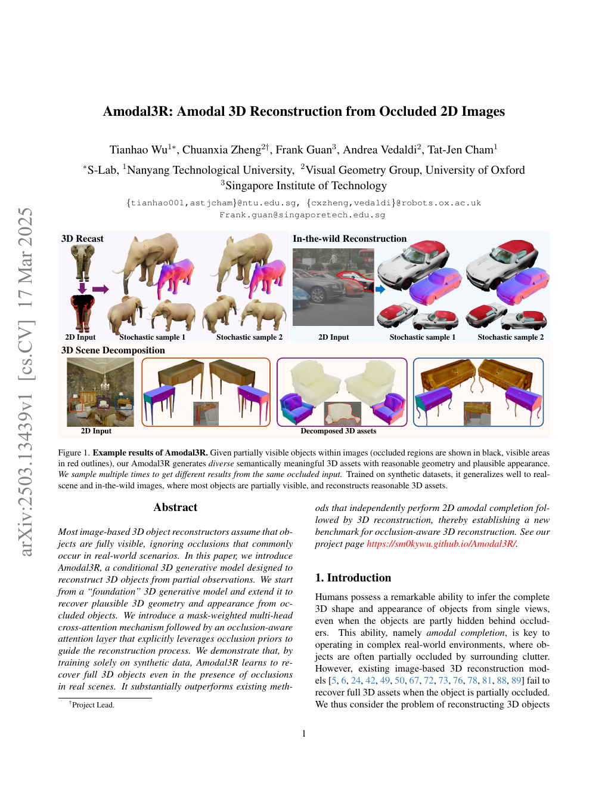
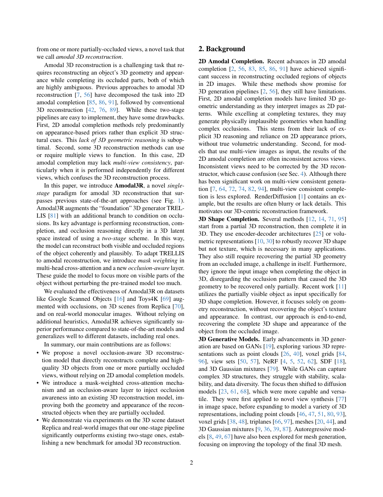
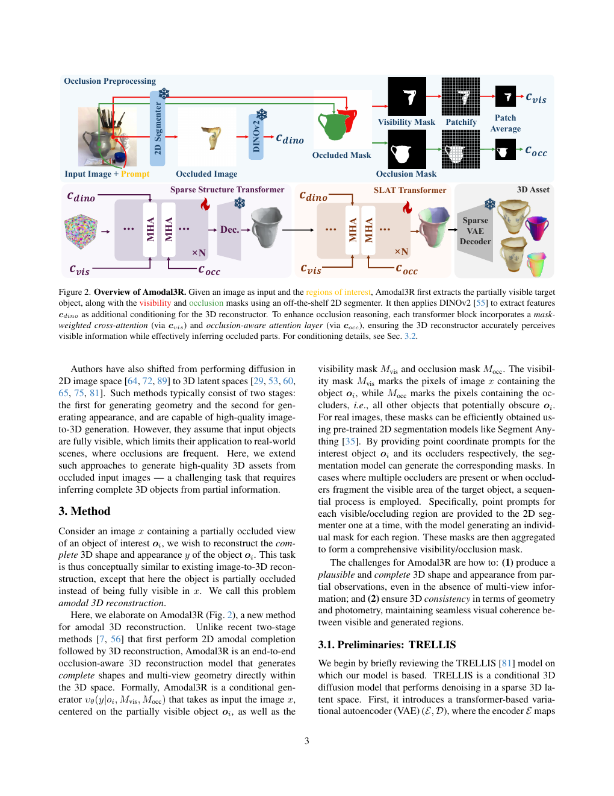
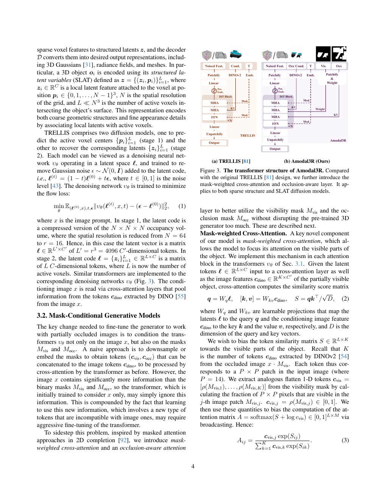
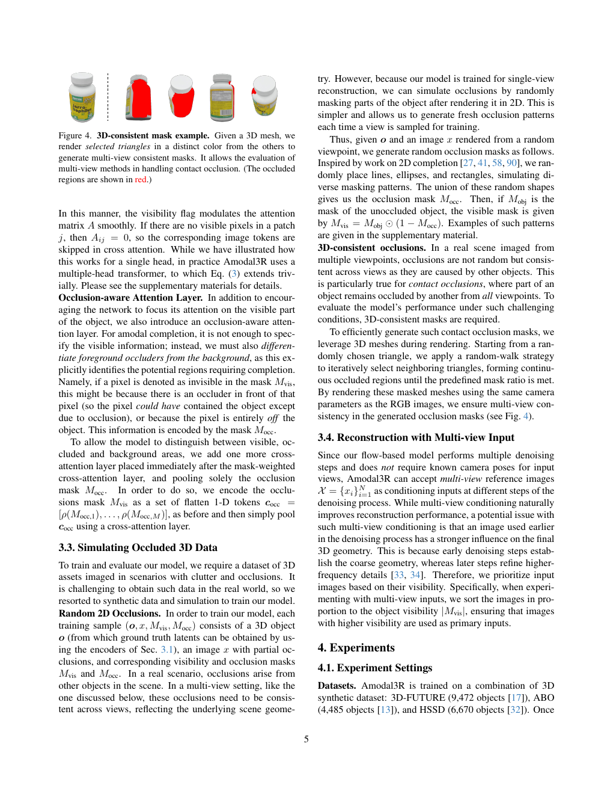
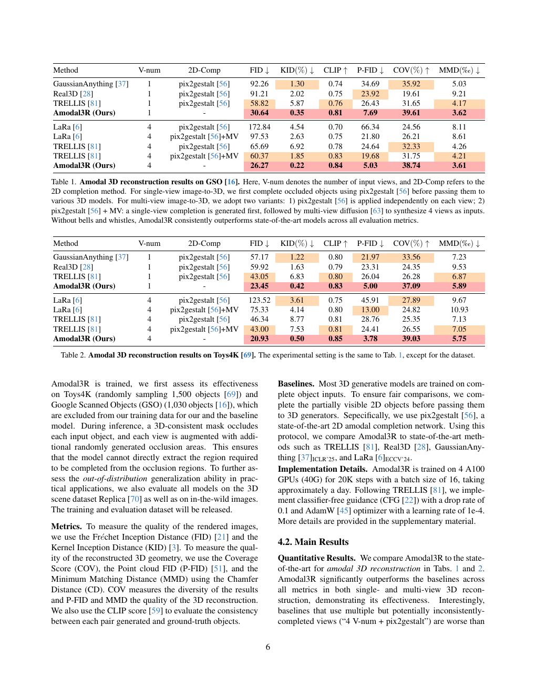
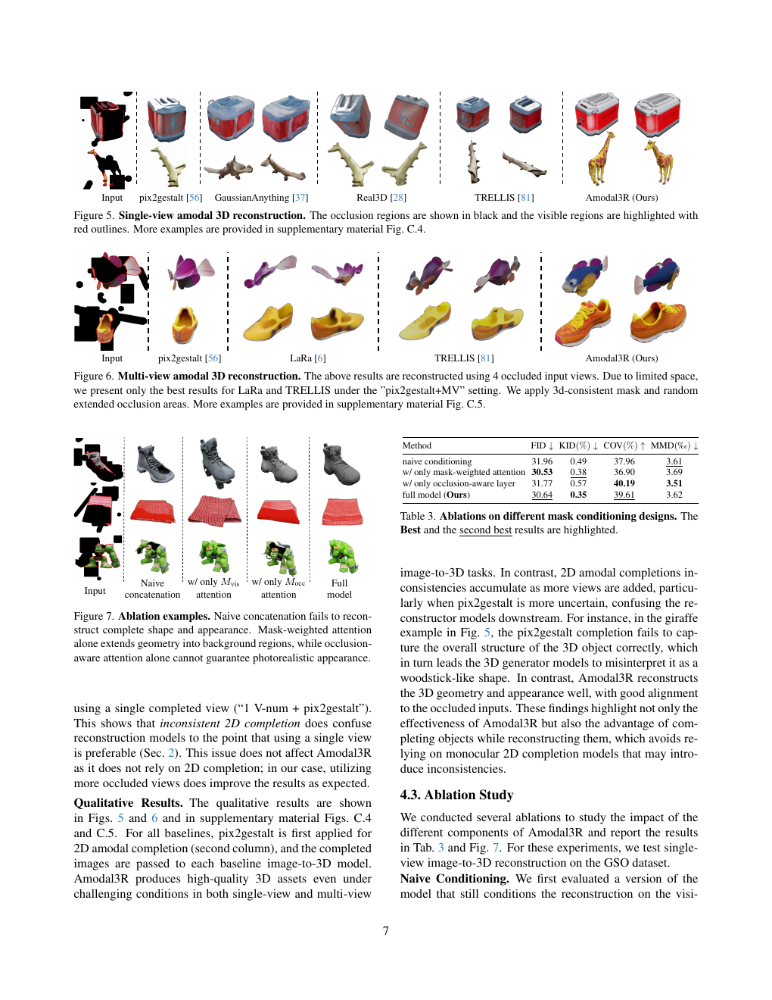
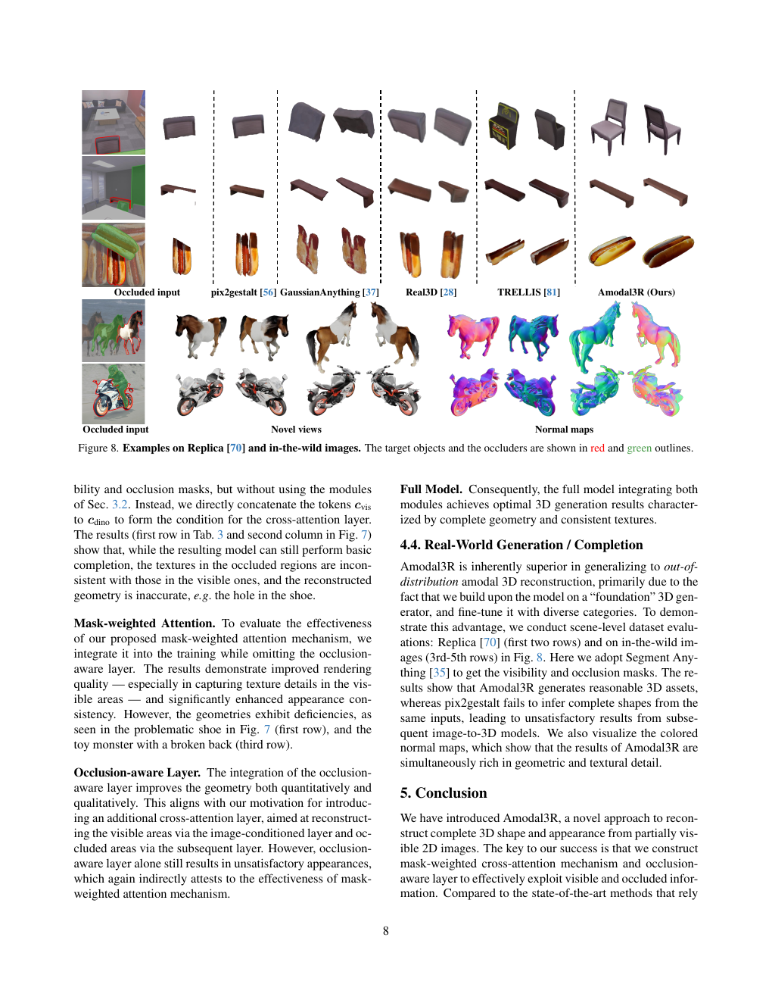

# Amodal3R: Amodal 3D Reconstruction from Occluded 2D Images — Nature Reader

**源文：** [arXiv:2503.13439](https://arxiv.org/abs/2503.13439)，22页 PDF；阅读月份 2026-11，发表月份 2025-03。

## 页面索引

p.1 摘要与引言；p.2 任务定义/相关工作；p.3 总体架构；p.4 TRELLIS 与 mask-weighted attention；p.5 occlusion-aware attention/数据模拟/多视图；p.6 设置与主表；p.7 定性结果与消融；p.8 真实场景与结论；p.9–13 参考文献；p.14–22 补充材料与限制。

## 公式索引

| Anchor | Page | 内容 |
|---|---:|---|
| E001 | 4 | flow matching path |
| E002 | 4 | flow loss |
| E003 | 4 | cross-attention score |
| E004 | 4 | visibility-weighted attention |
| E005 | 5 | visibility mask |

## 双语源文块

**Source:** p.1 · Abstract / Introduction · S001

**Original:** Most image-based 3D object reconstructors assume that objects are fully visible, ignoring occlusions that commonly occur in real-world scenarios.

**中文:** 多数基于图像的三维物体重建器假设物体完全可见，忽略了真实场景中普遍存在的遮挡。

**Source:** p.2 · Problem definition · S002

**Original:** We consider the problem of reconstructing 3D objects from one or more partially-occluded views, a novel task that we call amodal 3D reconstruction.

**中文:** 论文把从一个或多个部分遮挡视角恢复完整三维物体定义为 amodal 3D reconstruction。

**Source:** p.2 · Motivation · S003

**Original:** 2D amodal completion methods rely predominantly on appearance-based priors rather than explicit 3D structural cues.

**中文:** 二维非模态补全主要依赖外观先验，而不是显式三维结构线索；这会在复杂遮挡下产生物理上不合理的几何。

**Source:** p.3 · Method overview · S004

**Original:** Amodal3R augments the foundation 3D generator TRELLIS with an additional branch to condition on occlusions.

**中文:** Amodal3R 在 TRELLIS 这个 foundation 3D generator 上增加遮挡条件分支，在三维 latent 空间同时处理重建、补全和遮挡推理。

**Source:** p.4 · Flow objective · S005

**Original:** The denoising network is trained to minimize the flow loss.

**中文:** 模型在 structured 3D latent 上用 flow matching 学习从噪声回到目标 latent 的速度场。

**Source:** p.4 · Mask-weighted attention · S006

**Original:** We wish to bias the token similarity matrix towards the visible parts of the object.

**中文:** visibility mask 被转成 patch 权重并加入 attention logits，使模型优先读取可见目标区域；完全不可见 patch 的权重为零。

**Source:** p.5 · Occlusion-aware attention · S007

**Original:** It is not enough to specify the visible information; instead, we must also differentiate foreground occluders from the background.

**中文:** 只标记可见区域还不够，还要把前景遮挡者与背景区分开，因为前者解释了哪些区域可能属于目标却暂时不可见。

**Source:** p.5 · Synthetic data · S008

**Original:** To efficiently generate such contact occlusion masks, we leverage 3D meshes during rendering.

**中文:** 论文利用三维 mesh 的邻接三角形随机游走生成接触遮挡，从而保证同一对象的多视角遮挡模式一致。

**Source:** p.6 · Evaluation · S009

**Original:** Amodal3R significantly outperforms the baselines across all metrics in both single- and multi-view 3D reconstruction.

**中文:** 在 GSO 与 Toys4K 的单视图和多视图评测中，论文报告 Amodal3R 在渲染、语义一致性和点云几何指标上都优于基线。

**Source:** p.7 · Ablation · S010

**Original:** The full model integrating both modules achieves optimal 3D generation results characterized by complete geometry and consistent textures.

**中文:** 消融显示两个模块互补：可见性加权更有利于外观，遮挡感知层更有利于几何，联合模型最稳定。

**Source:** p.8 · Real-world evidence · S011

**Original:** Amodal3R generates reasonable 3D assets on Replica and in-the-wild images.

**中文:** Replica 和真实图片结果支持模型的现实可用性，但这些样本缺少完整三维真值，因此不能由视觉合理性推出背面真实性。

**Source:** p.16 · Limitations · S012

**Original:** Completions on some complex or out-of-distribution objects may fail or lead to unrealistic structures.

**中文:** 作者承认训练数据规模有限且主要是 furniture，复杂或分布外对象可能失败；真实数据适配和可控补全仍未解决。

## 公式与优化行为

**E001 · p.4 · flow matching**

$$\ell(t)=(1-t)\ell^{(0)}+t\epsilon,\qquad \epsilon\sim\mathcal N(0,I),\quad t\in[0,1].$$

**E002 · p.4 · flow loss**

$$\min_\theta\mathbb E\left\|\upsilon_\theta(\ell(t),x,t)-(\epsilon-\ell^{(0)})\right\|_2^2.$$

**E003 · p.4 · cross-attention score**

$$q=W_q\ell,\qquad [k,v]=W_{kv}c_{\mathrm{dino}},\qquad S=\frac{qk^\top}{\sqrt D}.$$

**E004 · p.4 · visibility-weighted attention**

$$A=\operatorname{softmax}\!\left(S+\log c_{\mathrm{vis}}\right),\qquad A_{ij}=\frac{c_{\mathrm{vis},j}\exp(S_{ij})}{\sum_{k=1}^{K}c_{\mathrm{vis},k}\exp(S_{ik})}.$$

**E005 · p.5 · visibility mask**

$$M_{\mathrm{vis}}=M_{\mathrm{obj}}\odot(1-M_{\mathrm{occ}}).$$

E001–E005 的符号依据 PDF p.4–5 核对；PDF 文本层对上下标和字距有轻微编码噪声，公式以页面图像为准。三态 belief 扩展只在精读长文中标为研究假设。

## 图表与页面资产

图 1（p.1）展示同一遮挡输入的多次 stochastic samples；图 2（p.3）展示 occlusion preprocessing 与两级 transformer；图 3（p.4）对比 TRELLIS 和 Amodal3R block；图 4（p.5）展示 3D-consistent contact mask；表 1–3（p.6–7）给出主结果和消融；图 8（p.8）为 Replica/in-the-wild 结果。

## 术语表

| Term | 中文 | 直觉与作用 |
|---|---|---|
| amodal 3D reconstruction | 三维非模态重建 | 从部分可见证据推断完整 3D asset；未知背面仍可能多解。 |
| visibility mask | 可见性掩码 | 说明目标像素中哪些真正可见；用于 attention 权重。 |
| occlusion mask | 遮挡掩码 | 说明哪些不可见区域由前景遮挡者造成；区分 unknown 与 background。 |
| SLAT | Structured Latent | 将局部 latent 绑定到 active voxels，兼顾几何和外观。 |
| 3D-consistent mask | 三维一致遮挡 | 用 mesh 邻接关系生成跨视角一致的接触遮挡。 |
| plausible | 合理/似然较高 | 只表示符合先验与观测，不等于隐藏真值。 |

## 证据边界与阅读提示

本文把原文事实、基于表格/图示的解释和迁移推断分开。论文的定量结果来自合成对象的有完整真值评测；Replica 与 in-the-wild 只提供视觉证据。未运行官方模型，未核验所有 supplementary qualitative figure 的逐像素内容，也没有把 sample diversity 当作后验校准。
