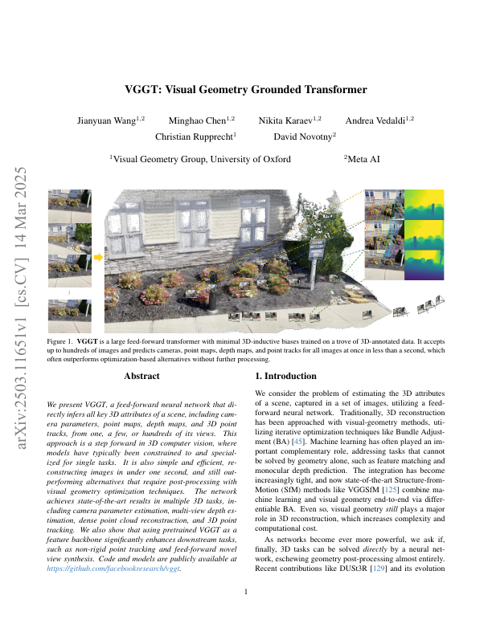
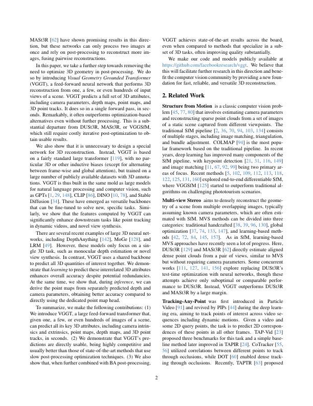
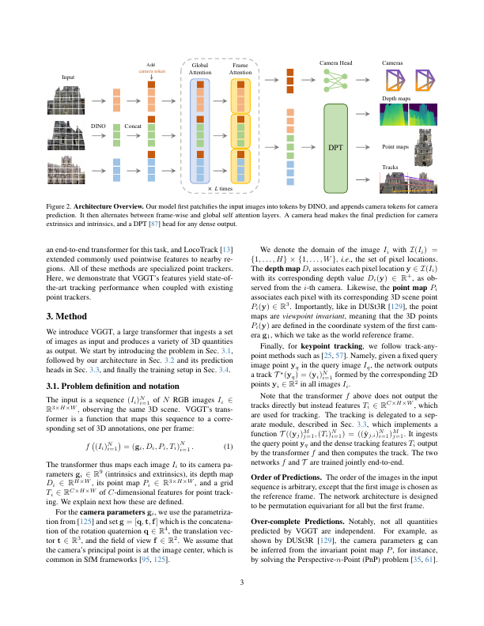
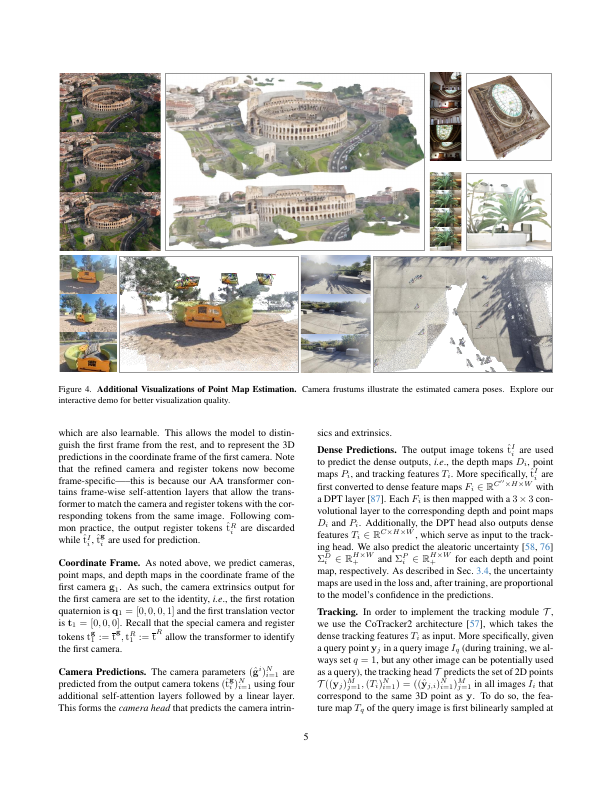
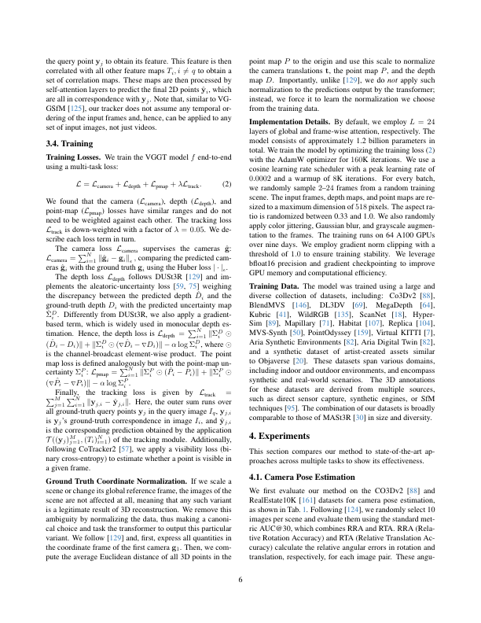
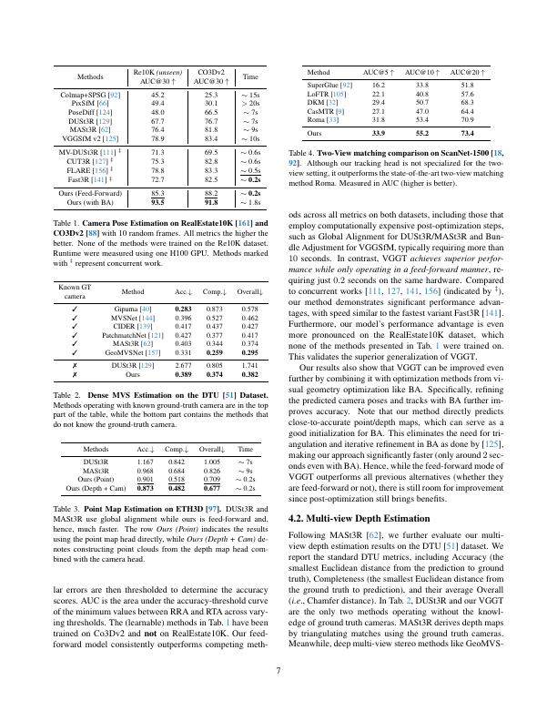

# VGGT: Visual Geometry Grounded Transformer — Nature Reader

> source_format: pdf-text；原文：arXiv:2503.11651v1（2025-03-14）；本文 reader 基于本地 PDF 文本层与页面资产。图表页资产为整页低分辨率裁剪，未对每个图表做像素级 tight crop。

## 论文结构索引
Abstract；1 Introduction；2 Related Work；3 Method（Problem、Feature Backbone、Prediction Heads、Training）；4 Experiments（camera、depth、point map、tracking、ablations）；5 Discussion/Limitations；Appendix/References。

## 双语源文块

**Source:** p.1 S001（abstract；confidence=high）

**Original:** We present VGGT, a feed-forward neural network that directly infers all key 3D attributes of a scene, including camera parameters, point maps, depth maps, and 3D point tracks, from one, a few, or hundreds of its views.

**中文:** 本文提出 VGGT，一种前馈神经网络，能够从场景的一张、少量或数百张视图中直接推断关键三维属性，包括相机参数、点图、深度图和三维点轨迹。

**Source:** p.1 S002（introduction；confidence=high）

**Original:** We ask if, finally, 3D tasks can be solved directly by a neural network, eschewing geometry post-processing almost entirely.

**中文:** 作者提出核心问题：三维任务是否终于可以主要由神经网络直接解决，而几乎不再依赖几何后处理？

**Source:** p.3 S003（problem；confidence=medium）

**Original:** f((I_i)_{i=1}^N) = (g_i, D_i, P_i, T_i)_{i=1}^N.

**中文:** 模型把多视图图像映射为每帧的相机参数、深度图、点图和跟踪特征。

**Equation anchor:** E001

$$ f((I_i)_{i=1}^N)=(g_i,D_i,P_i,T_i)_{i=1}^N $$

**Source:** p.4 S004（architecture；confidence=high）

**Original:** Frame-wise self-attention attends to the tokens within each frame separately, and global self-attention attends to the tokens across all frames jointly.

**中文:** 帧内注意力分别处理每一帧的 token；全局注意力则联合处理所有帧的 token。二者交替，使模型既保留单帧结构，又能建立跨视角关系。

**Source:** p.5 S005（loss；confidence=medium）

**Original:** L = L_camera + L_depth + L_pmap + αL_track, with α = 0.05.

**中文:** 训练损失由相机、深度、点图和跟踪四项组成，其中跟踪损失使用 α=0.05 的较小权重。

**Equation anchor:** E002

$$ L=L_{camera}+L_{depth}+L_{pmap}+0.05L_{track} $$

**Source:** p.6 S006（training；confidence=high）

**Original:** The training runs on 64 A100 GPUs over nine days.

**中文:** 论文报告训练使用 64 张 A100 GPU，持续九天。这是可复现性和迁移成本的重要边界。

**Source:** p.7 S007（result；confidence=high）

**Original:** Our feed-forward model consistently outperforms competing methods on both datasets, including those that employ computationally expensive post-optimization steps.

**中文:** 作者报告前馈模型在两个数据集上持续优于竞争方法，包括需要昂贵后优化的模型；这一结论只覆盖论文所测的相机估计任务。

**Source:** p.9 S008（limitation；confidence=high）

**Original:** During inference, combining independently estimated depth maps and camera parameters produces more accurate 3D points compared to directly employing a specialized point map branch.

**中文:** 推理时，将独立预测的深度图和相机参数组合起来得到的三维点，比直接使用专门的点图分支更准确。这说明多任务冗余在训练和推理阶段的作用不同。

## 关键图表与公式

### Figure 1 / Figure 2
Figure 1 说明模型从一张到数百张图像输出相机、深度、点图和轨迹；Figure 2 展示 DINO tokens、camera/register tokens、交替 frame/global attention 和多个 prediction heads。页面资产：

### Figure 3 / Figure 4 / Figure 5
Figure 3 对比 VGGT 与 DUSt3R 的点图；Figure 4 展示点图和相机 frustums；Figure 5 展示静态与动态点跟踪。页面资产：

### Tables 1–4
Tables 1–4 分别覆盖相机姿态、DTU 深度、ETH3D 点图和两视图匹配。作者报告 feed-forward VGGT 在相机姿态上达到较高 AUC，并在 ETH3D 中 depth+camera 组合优于直接 point head；这些是原文表格结论，不能外推到未观测背面。

### 公式索引
- **E001：** `f((I_i)_{i=1}^N) = (g_i,D_i,P_i,T_i)_{i=1}^N`，定义输入到多任务几何输出的映射。
- **E002：** `L=L_camera+L_depth+L_pmap+0.05L_track`，体现多任务监督和 tracking 的降权。

**E003：** 深度/点图的 uncertainty-weighted residual，训练中降低高不确定区域的梯度权重，同时记录预测置信度。
$$ \text{uncertainty-weighted residual} $$

**E004：** tracking visibility BCE，表示同一查询点在不同帧中可见与否。
$$ \text{visibility BCE} $$

## 分节精读
### Abstract / Introduction
论文真正解决的是多视图几何的测试时优化成本与多任务割裂。它没有证明任意输入都能恢复完整三维；论文结果依赖大规模多源训练、相对静态场景和相机/尺度规范化。

### Method
方法的关键不是一个特殊 3D 算子，而是把多视图 token 组织成共享场景状态。frame-wise attention 把单帧统计稳定下来，global attention 让跨视角证据相互影响；第一帧 token 固定坐标参考；camera、depth、point-map、track heads 提供冗余监督。这个设计对三维 amodal 的真正启发是“证据汇聚”和“状态接口”，而不是把 point map 直接当完整形状。

### Results
实验回答了四个问题：前馈相机估计是否可与后优化竞争；未知相机的深度是否可用；多头输出是否互相帮助；几何 backbone 是否能迁移到跟踪和新视角任务。答案在论文评测集上总体为是，但 BA 仍能改善，说明前馈预测是强初始化而不是完美几何求解。

### Discussion / Evidence boundary
对 amodal 补全必须增加 observed/inferred/unknown 三态、候选形状、可见硬约束和后续视角否证。若同一可见输入有多个背面，deterministic point map 的低误差只代表选中了训练先验，不代表恢复了真实背面。论文 uncertainty 不是已证明的 hidden epistemic calibration；应通过多头 disagreement、候选覆盖和 selective risk 单独验证。

## 术语表
| English | 中文 | 在论文中的作用 |
|---|---|---|
| viewpoint-invariant point map | 视角不变点图 | 用第一帧坐标系表达多视角对应的三维点 |
| alternating attention | 交替注意力 | 在帧内建模与跨帧融合之间切换 |
| camera token | 相机 token | 汇聚每帧相机参数预测所需信息 |
| aleatoric uncertainty | 偶然不确定性 | 对深度/点图残差做预测加权 |
| bundle adjustment | 光束法平差 | 传统/后处理几何优化，可继续改进 VGGT 输出 |

## 证据边界与未解决问题
- 高置信度：标题、摘要、结构、方法映射、损失组成、训练资源、主要表格结论。
- 中置信度：PDF 文本层对公式符号有编码替换；E003/E004 按论文结构重排，必要时应回看原始页面。
- 未核验：模型运行、官方代码输出、在真实遮挡/三维 amodal 数据上的效果。
- 未解决：完全未观测表面的不可辨识性、动态遮挡身份交换、透明/镜面材质、相机内参错配、hidden uncertainty calibration。

## 迁移结论（明确标注为研究假设）
VGGT 最值得迁移的是跨视角证据汇聚、共享参考坐标和多任务一致性；需要新增的是三态 belief、多候选 shape、可见硬约束和主动视角否证。任何从本文直接推断“可恢复真实背面”的说法都超出原文证据。